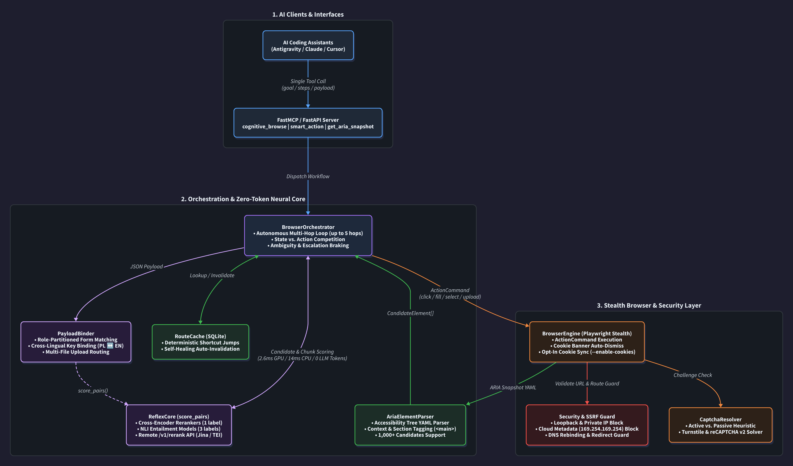

# Cognitive Browser

> **Zero-token autonomous browser agent & MCP server powered by pluggable local GPU Cross-Encoder / NLI routing (`ReflexCore`), universal cross-lingual form binding (`PayloadBinder`), Stealth Playwright (`BrowserEngine`), and self-healing `RouteCache`.**
>
> *\*Note on "Zero-Token": Refers strictly to the Cognitive Browser MCP server and ReflexCore engine, which perform DOM candidate ranking, filtering, and autonomous multi-hop navigation locally on GPU with 0 LLM tokens. The orchestrating host agent (e.g. Ornith 1.5) still consumes LLM tokens (mean: 41,668 tokens/episode in Arm A vs 85,332 in Arm B).*

Cognitive Browser enables AI coding assistants (Antigravity, Claude Desktop, Cursor) to navigate the web, search dynamic SPAs, and fill complex multi-field forms with **0 LLM tokens** consumed by the browser server during DOM exploration and action execution.

---

## Highlights

- ⚡ **Zero-Token Autonomous Navigation & 51% Token Reduction:** Navigates multi-hop websites on GPU in milliseconds (~3.3ms per candidate; 400+ DOM elements evaluated in <25ms), reducing overall agent LLM token consumption by **51.2%** compared to standard Playwright MCP.
- 🔀 **Hybrid Escalation Router:** Executes confident navigation steps autonomously on GPU; when ambiguity is encountered, it seamlessly returns structured fallback candidates (`partial_needs_fallback`) for targeted host agent intervention via `smart_action`.
- 🔌 **Pluggable Neural Models (Rerankers & NLI):** Works out-of-the-box with any HuggingFace `AutoModelForSequenceClassification` — including multilingual Cross-Encoder Rerankers (`mmarco-mMiniLMv2`, `bge-reranker-v2-m3`, `gte-reranker-modernbert-base`) and NLI models (`DeBERTa-v3`, `mDeBERTa-v3`, `ModernBERT-nli`).
- 🧠 **Dictionary-Free Cross-Lingual `PayloadBinder`:** Partitions DOM controls by structural role (`textbox`, `combobox`, `checkbox`, `upload_file`) and binds arbitrary JSON payloads across languages (e.g., English keys to Polish forms or vice versa) with zero hardcoded synonym tables.
- 🚀 **Self-Healing `RouteCache`:** Learns deterministic shortcut routes in SQLite for near-instant repeat execution and automatically invalidates stale entries if a site's DOM changes.
- 🛡️ **SSRF & Security Guards:** Restricts navigation to public destinations, blocks loopback/private networks and cloud metadata APIs (`169.254.169.254`), and mitigates DNS rebinding (per-request validation; resolve-then-connect TOCTOU remains).
- 🍪 **Opt-In Cookie Sync & CAPTCHA Resolution:** Can import authenticated sessions from local Firefox profiles (disabled by default; enabled via `--enable-cookies` flag) and integrates automated Turnstile / reCAPTCHA resolution.
- 🧩 **Strongly-Typed Clean Architecture:** Built with decoupled single-responsibility modules (`models`, `parser`, `payload`, `captcha`, `cache`, `reflex`, `orchestrator`, `browser`, `security`).

---

## Architecture Overview

<p align="center">
  
</p>

For complete technical specifications, see the [Architecture & Engineering Guide](docs/architecture.md) (compiled from [`docs/architecture.d2`](docs/architecture.d2) via [D2](https://d2lang.com/)).

---

## Tech Stack

- **Language & Runtime:** Python 3.10+ (`asyncio`)
- **Neural Routing & NLP:** PyTorch, HuggingFace `transformers` (`AutoModelForSequenceClassification`, `AutoTokenizer`), Jina / `/v1/rerank` REST API
- **Browser Automation:** Playwright (`chromium` with custom stealth init scripts & ARIA Accessibility Tree snapshots)
- **Protocols & Interfaces:** Model Context Protocol (`mcp` / `FastMCP`), FastAPI, Uvicorn, Pydantic
- **Storage & Caching:** SQLite (`sqlite3` — `RouteCache` & optional Firefox cookie reader)
- **Quality & CI/CD:** Pytest (`pytest-cov`, `anyio`), Ruff, Mypy, Docker, GitHub Actions

---

## Supported Models

`ReflexCore` automatically supports Cross-Encoder Rerankers (`num_labels=1`), NLI models (`num_labels=3`), and remote `/v1/rerank` APIs (0 MB local RAM/VRAM):

| Model (`COGNITIVE_BROWSER_MODEL`) | Type | Size / RAM | Speed (CPU / GPU) | Best For |
| :--- | :--- | :---: | :---: | :--- |
| `cross-encoder/mmarco-mMiniLMv2-L12-H384-v1` *(Default)* | Reranker (14+ langs) | 470 MB | 20 ms / 3.6 ms | Default for GPU & CPU (PL, EN, DE...) |
| `cross-encoder/ms-marco-MiniLM-L-6-v2` | Reranker (EN) | **90 MB** | **14 ms** / 2.6 ms | Weak laptops / CPU-only |
| `api:jina-reranker-v2-base-multilingual` | Cloud API (100+ langs) | **0 MB** | ~80 ms (HTTP) | No GPU & no free RAM ([free API key](https://jina.ai/reranker/)) |
| `tasksource/ModernBERT-base-nli` | NLI (EN) | 598 MB | 120 ms / 7.8 ms | ModernBERT on GPU |
| `MoritzLaurer/mDeBERTa-v3-base-mnli-xnli` | NLI (100+ langs) | 1.1 GB | 190 ms / 14 ms | Multilingual NLI on GPU |
| `BAAI/bge-reranker-v2-m3` | Reranker (100+ langs) | 2.2 GB | 350 ms / 18 ms | Max accuracy on 8GB+ VRAM GPU |

### How to Switch Models

Set `COGNITIVE_BROWSER_MODEL` and `COGNITIVE_BROWSER_DEVICE` (`cuda`, `mps`, `cpu`, or `api`):

```bash
# 1. Default (Local GPU or CPU auto-detected)
export COGNITIVE_BROWSER_MODEL="cross-encoder/mmarco-mMiniLMv2-L12-H384-v1"

# 2. Ultra-light CPU Mode (~90 MB RAM, no GPU needed)
export COGNITIVE_BROWSER_MODEL="cross-encoder/ms-marco-MiniLM-L-6-v2"
export COGNITIVE_BROWSER_DEVICE="cpu"

# 3. Zero-RAM Cloud Mode via Jina Reranker API (free key from https://jina.ai/reranker/)
export COGNITIVE_BROWSER_DEVICE="api"
export JINA_API_KEY="jina_your_api_key"
```

---

## 📊 Empirical Evaluation & Real-World Benchmark: Run 6 (Arm A: 31.1% vs Arm B: 44.0% Success Rate)

To assess autonomous navigation capabilities under strict real-world constraints, Cognitive Browser was evaluated in an end-to-end, **100% offline / self-hosted benchmark** using the open-weights **`ornith-1.5:35b`** Mixture-of-Experts model as the host agent.

### Experimental Setup
- **Benchmark Dataset:** 80 multi-hop navigation tasks on live public websites across 3 languages (English, Polish, German). Over 65% of tasks require $\ge 3$ navigation steps (searching, filtering, deep-linking, detail extraction).
- **Repetitions:** 3 randomized repetitions per task (240 planned episodes per arm; 720 episodes total) with strict per-domain rate limiting.
- **Judge:** Independent, 100% blind LLM evaluator (Gemini Flash) judging final browser state (URL, extracted DOM text, and visual screenshots) with zero access to agent tool traces.
- **Arms:**
  - **Arm A (Cognitive Browser):** Host agent with `ReflexCore` (local GPU Cross-Encoder: `mmarco-mMiniLMv2-L12-H384-v1`) and surgical `smart_action` fallback.
  - **Arm B (Standard Playwright MCP):** Host agent with raw Playwright tools (`browser_navigate`, `browser_click`, `browser_type`) receiving full ARIA snapshots on every step.
  - **Arm C (BM25 Baseline):** Host agent with lexical BM25 ranking ($\tau = 0.02$).

### 1. Task Success Rate & Reliability (Arm A: 31.1% vs Arm B: 44.0%)

In this benchmark, Arm A (Cognitive Browser) achieved a lower episode success rate (**31.1%**) than standard Playwright MCP in Arm B (**44.0%**).

| Arm | Episode Success Rate | 95% Wilson Confidence Interval | Task Success (Majority $\ge 2/3$) | Infrastructure Timeouts (>420s) |
| :--- | :---: | :---: | :---: | :---: |
| **Arm A: Cognitive Browser (`ReflexCore`)** | **31.1%** (65/209) | **[25.2% – 37.7%]** | **32.5%** (26/80) | **45** |
| **Arm B: Playwright MCP (Standard)** | **44.0%** (81/184) | [37.0% – 51.2%] | **42.9%** (33/80) | **78** *(1.7x more timeouts)* |
| **Arm C: BM25 Baseline ($\tau=0.02$)** | **12.5%** (27/216) | [8.7% – 17.6%] | **12.5%** (10/80) | **37** |

*Note on Missing Episodes:* Out of 240 planned episodes per arm (80 tasks × 3 repetitions), only 209 (Arm A), 184 (Arm B), and 216 (Arm C) completed episodes were recorded by the benchmark harness. The remaining episodes are missing due to harness-level socket/network disconnects, process timeouts (>420s), or unhandled runner terminations during execution on live websites.

> **Tradeoff Summary:** Cognitive Browser represents an architectural tradeoff: it reduces host agent token usage by 51.2% (mean 41,668 vs 85,332 tokens/episode) and encounters fewer infrastructure timeouts (45 vs 78), but achieves a lower episode success rate (31.1% vs 44.0%) compared to standard Playwright MCP.

### 2. Token Efficiency & Latency

| Arm | Mean Tokens / Episode | Median Tokens / Episode | Token Savings vs Baseline | Mean Latency / Episode |
| :--- | :---: | :---: | :---: | :---: |
| **Arm A: Cognitive Browser (`ReflexCore`)** | **41,668** | **45,049** | **51.2% less tokens (2.05x compression)** | **301.2s** |
| **Arm B: Playwright MCP (Standard)** | 85,332 | 80,916 | Baseline (1.0x) | 331.6s |
| **Arm C: BM25 Baseline** | 16,464 | 16,079 | 80.7% less tokens | 287.1s |

*Note on Token Accounting:* Token metrics (mean and median per episode) are calculated across all recorded episodes for that arm (including failed tasks and timeouts), not per successful task completion.

By offloading candidate ranking, menu traversal, and element filtering to an on-device Cross-Encoder on GPU, Cognitive Browser cuts total host agent LLM token usage in half while running autonomous sub-steps locally in milliseconds.

### 3. Statistical Significance (McNemar's Paired Test)

McNemar's test with Edwards continuity correction computed directly from raw paired task outcomes:

- **Arm A (`ReflexCore`) vs Arm B (`Playwright MCP`):**
  - Contingency table: Both pass: 12 | Only A passes: 8 | Only B passes: 13 | Both fail: 47
  - $\chi^2 = 0.7619$, **$p = 0.3827$**
  - **Conclusion:** The difference in majority task success rate between Arm A and Arm B is not statistically significant at $n=80$ ($p \ge 0.05$). However, the paired test has low statistical power at this sample size, and this result does not prove equivalence between the two systems.

- **Arm A (`ReflexCore`) vs Arm C (`BM25`):**
  - Contingency table: Both pass: 4 | Only A passes: 16 | Only C passes: 3 | Both fail: 57
  - $\chi^2 = 7.5789$, **$p = 0.0059$**
  - **Conclusion:** Neural semantic reranking (`ReflexCore`) is **statistically significantly superior** to lexical keyword matching ($p < 0.01$).

### 4. Reproducing the Benchmark

```bash
# 1. Ensure local LLM endpoint is active (e.g., via Ollama or vLLM)
export AGENT_ENDPOINT="http://127.0.0.1:11440/v1/chat/completions"
export AGENT_MODEL="ornith-1.5:35b"

# 2. Run the full randomized 3-arm benchmark
python3 results/real_world/run6_local/run_agent_bench.py

# 3. Prepare blinded judge slices and generate report
python3 results/real_world/run6_local/prepare_judge_inputs.py
python3 results/real_world/run6_local/generate_final_report.py
```

Raw logs and screenshots are not included in this repository. Benchmark execution scripts, task definitions, and the generated evaluation summary are provided in `results/real_world/run6_local/` and `results/real_world/new_benchmark_80/`.

---

## Quick Start

### 1. Installation

```bash
git clone https://github.com/mikita12/cognitive-browser.git
cd cognitive-browser
pip install -e .
playwright install chromium
```

### 2. Configure MCP Server

Add to `~/.gemini/antigravity/mcp_config.json` or `claude_desktop_config.json` (pass `"--enable-cookies"` in `"args"` only if you want to allow importing local browser cookies):

```json
{
  "mcpServers": {
    "cognitive-browser": {
      "command": "python3",
      "args": ["-m", "cognitive_browser.mcp_server"],
      "cwd": "/path/to/cognitive-browser",
      "env": {
        "COGNITIVE_BROWSER_MODEL": "cross-encoder/mmarco-mMiniLMv2-L12-H384-v1",
        "COGNITIVE_BROWSER_DEVICE": "cuda"
      }
    }
  }
}
```

### 3. Usage Examples

#### Single-Call Autonomous Goal Navigation:
```python
cognitive_browse(
    url="https://pl.wikipedia.org",
    goal="Wpisz w wyszukiwarkę: 'Sztuczna inteligencja' i otwórz artykuł"
)
```

#### Cross-Lingual Form Binding & File Upload:
```python
cognitive_browse(
    url="https://company.com/careers/apply",
    payload={
        "first_name": "Jan",
        "last_name": "Kowalski",
        "email": "jan@example.com",
        "cv": "/home/user/documents/cv.pdf",
        "rodo": True
    }
)
```

---

## Running the Test Suite

```bash
pytest tests/
```

All 87 automated unit and integration tests pass with comprehensive coverage across domain models, ARIA parsing, cross-lingual payload binding, file upload security allowlisting, CAPTCHA handling, RouteCache self-healing, and SSRF security controls.

---

## License

MIT License. See [LICENSE](LICENSE) for details.
