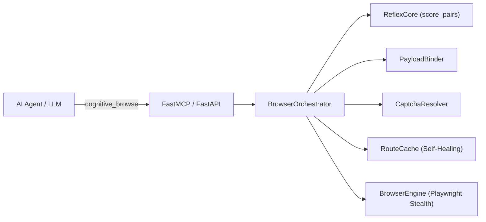

# Cognitive Browser

> **Zero-token autonomous browser agent & MCP server powered by pluggable local GPU Cross-Encoder / NLI routing (`ReflexCore`), universal cross-lingual form binding (`PayloadBinder`), Stealth Playwright (`BrowserEngine`), and self-healing `RouteCache`.**

Cognitive Browser enables AI coding assistants (Antigravity, Claude Desktop, Cursor) to navigate the web, search dynamic SPAs, and fill complex multi-field forms with **0 LLM tokens** consumed during DOM exploration and action execution.

---

## Highlights

- ⚡ **Zero-Token Autonomous Navigation:** Navigates multi-hop websites on GPU in milliseconds (~3.3ms per candidate; 400+ DOM elements evaluated in <25ms).
- 🔌 **Pluggable Neural Models (Rerankers & NLI):** Works out-of-the-box with any HuggingFace `AutoModelForSequenceClassification` — including multilingual Cross-Encoder Rerankers (`mmarco-mMiniLMv2`, `bge-reranker-v2-m3`, `gte-reranker-modernbert-base`) and NLI models (`DeBERTa-v3`, `mDeBERTa-v3`, `ModernBERT-nli`).
- 🧠 **Dictionary-Free Cross-Lingual `PayloadBinder`:** Partitions DOM controls by structural role (`textbox`, `combobox`, `checkbox`, `upload_file`) and binds arbitrary JSON payloads across languages (e.g., English keys to Polish forms or vice versa) with zero hardcoded synonym tables.
- 🚀 **Self-Healing `RouteCache`:** Learns deterministic shortcut routes in SQLite for near-instant repeat execution and automatically invalidates stale entries if a site's DOM changes.
- 🛡️ **SSRF & Security Guards:** Restricts navigation to public destinations, blocks loopback/private networks and cloud metadata APIs (`169.254.169.254`), and protects against DNS rebinding.
- 🍪 **System Cookie Sync & CAPTCHA Resolution:** Imports authenticated sessions from local Firefox profiles and integrates automated Turnstile / reCAPTCHA resolution.
- 🧩 **Strongly-Typed Clean Architecture:** Built with decoupled single-responsibility modules (`models`, `parser`, `payload`, `captcha`, `cache`, `reflex`, `orchestrator`, `browser`, `security`).

---

## Architecture Overview



For complete technical specifications, see the [Architecture & Engineering Guide](docs/architecture.md).

---

## Supported Models, Low-RAM CPU Mode & Jina Reranker API

`ReflexCore` is model-agnostic. At startup it inspects `model.config.num_labels` (or remote API configuration) and automatically switches between:
1. **Cross-Encoder Rerankers (`num_labels = 1`, sigmoid calibration)** — direct `[query, element_description]` scoring.
2. **NLI Entailment Models (`num_labels = 3`, entailment vs. contradiction softmax)** — hypothesis-based scoring.
3. **Remote Reranker API Mode (`0 MB local RAM/VRAM`)** — offloads scoring to **Jina AI Reranker API** (`https://api.jina.ai/v1/rerank`) or any `/v1/rerank`-compatible endpoint (Cohere, HuggingFace TEI, vLLM) so users without a dedicated GPU or extra RAM can run at full accuracy.

### Benchmarked Model Comparison

| Model / Mode | Type | Languages | Weights Size | Local VRAM / RAM | CPU Latency *(8 cands)* | GPU Latency *(8 cands)* | Best Use Case |
| :--- | :---: | :---: | :---: | :---: | :---: | :---: | :--- |
| **`api:jina-reranker-v2-base-multilingual`** *(Jina Cloud API)* | Cloud Reranker | 100+ (PL, EN, DE...) | **0 MB** | **0 MB** | ~65–120 ms *(HTTP)* | N/A *(Cloud)* | **No GPU & Low RAM** (1M free tokens on Jina AI) |
| **`cross-encoder/ms-marco-MiniLM-L-6-v2`** | Reranker (`1` label) | EN (+ basic Latin) | **90 MB** | ~180 MB | **14.1 ms** | **2.6 ms** | **Ultra-light CPU laptops** & fast English browsing |
| **`cross-encoder/mmarco-mMiniLMv2-L12-H384-v1`** *(Default)* | Reranker (`1` label) | 14+ (PL, EN, DE, ES...) | **470 MB** | ~480 MB | **20.0 ms** | **3.6 ms** | **Best all-around default** for both CPU & GPU |
| **`tasksource/ModernBERT-base-nli`** | NLI (`3` labels) | EN | **598 MB** | ~650 MB | 120.8 ms | **7.8 ms** | FlashAttention-2 / long-context NLI on GPU |
| **`MoritzLaurer/mDeBERTa-v3-base-mnli-xnli`** | NLI (`3` labels) | 100+ | ~1.1 GB | ~1.2 GB | ~190 ms | ~14.5 ms | Heavy zero-shot multilingual NLI on GPU |
| **`BAAI/bge-reranker-v2-m3`** | Reranker (`1` label) | 100+ | ~2.2 GB | ~2.3 GB | ~350 ms | ~18.0 ms | Maximum accuracy on 8GB+ VRAM GPUs |

---

### Option A: Zero-VRAM / Low-RAM Cloud Mode via Jina Reranker API

If your machine has **no dedicated GPU** and **limited RAM**, you can use **Jina AI's Reranker API** (`jina-reranker-v2-base-multilingual`) without downloading PyTorch weights locally:

1. Get a free API key (includes 1,000,000 free tokens) at **[https://jina.ai/reranker/](https://jina.ai/reranker/)**.
2. Set `JINA_API_KEY` in your environment (or MCP configuration):
   ```bash
   export JINA_API_KEY="jina_xxxxxxxxxxxxxxxxxxxxxxxx"
   export COGNITIVE_BROWSER_DEVICE="api"
   ```
   *(When `JINA_API_KEY` is set, `ReflexCore` automatically routes scoring requests to `https://api.jina.ai/v1/rerank` with model `jina-reranker-v2-base-multilingual` and skips loading any local HuggingFace model.)*

> [!TIP]
> **Self-Hosted / Custom Rerank API:** You can also point `Cognitive Browser` to any self-hosted Text Embeddings Inference (TEI), vLLM `/v1/rerank`, or Cohere endpoint via `RERANK_API_URL="https://your-endpoint/v1/rerank"` and `RERANK_API_KEY="..."`.

---

### Option B: Lightweight Local CPU Mode (No GPU Required, 100% Offline)

Even without a GPU or API key, `Cross-Encoder` MiniLM models run in **14–20 ms on a standard CPU**:

- **Ultra-Light CPU (~90 MB download, ~14 ms latency):**
  ```bash
  export COGNITIVE_BROWSER_MODEL="cross-encoder/ms-marco-MiniLM-L-6-v2"
  export COGNITIVE_BROWSER_DEVICE="cpu"
  ```
- **Multilingual CPU — Polish, English, German, etc. (~470 MB download, ~20 ms latency):**
  ```bash
  export COGNITIVE_BROWSER_MODEL="cross-encoder/mmarco-mMiniLMv2-L12-H384-v1"
  export COGNITIVE_BROWSER_DEVICE="cpu"
  ```

---

## Quick Start

### 1. Installation

```bash
git clone https://github.com/mikita12/cognitive-browser.git
cd cognitive-browser
pip install -e .
playwright install chromium
```

### 2. Configure MCP Server in Antigravity / Claude Desktop

Add Cognitive Browser to your MCP client configuration (`~/.gemini/antigravity/mcp_config.json` or `claude_desktop_config.json`):

#### Default (Auto-detects CUDA GPU / MPS / CPU):
```json
{
  "mcpServers": {
    "cognitive-browser": {
      "command": "python3",
      "args": ["-m", "cognitive_browser.mcp_server"],
      "cwd": "/path/to/cognitive-browser"
    }
  }
}
```

#### No-GPU / 0 MB RAM Mode (Jina Reranker API):
```json
{
  "mcpServers": {
    "cognitive-browser": {
      "command": "python3",
      "args": ["-m", "cognitive_browser.mcp_server"],
      "cwd": "/path/to/cognitive-browser",
      "env": {
        "COGNITIVE_BROWSER_DEVICE": "api",
        "JINA_API_KEY": "jina_your_api_key_here"
      }
    }
  }
}
```

#### Ultra-Light Local CPU Mode (~90 MB RAM):
```json
{
  "mcpServers": {
    "cognitive-browser": {
      "command": "python3",
      "args": ["-m", "cognitive_browser.mcp_server"],
      "cwd": "/path/to/cognitive-browser",
      "env": {
        "COGNITIVE_BROWSER_MODEL": "cross-encoder/ms-marco-MiniLM-L-6-v2",
        "COGNITIVE_BROWSER_DEVICE": "cpu"
      }
    }
  }
}
```

### 3. Usage Examples

#### Single-Call Autonomous Goal Navigation:
```python
cognitive_browse(
    url="https://pl.wikipedia.org",
    goal="Wpisz w wyszukiwarkę: 'Sztuczna inteligencja' i otwórz artykuł"
)
```

#### Cross-Lingual Form Binding & File Upload:
```python
cognitive_browse(
    url="https://company.com/careers/apply",
    payload={
        "first_name": "Jan",
        "last_name": "Kowalski",
        "email": "jan@example.com",
        "cv": "/home/user/documents/cv.pdf",
        "rodo": True
    }
)
```

---

## Running the Test Suite

```bash
pytest tests/
```

All 62 automated unit and integration tests pass with comprehensive coverage across domain models, ARIA parsing, cross-lingual payload binding, CAPTCHA handling, RouteCache self-healing, and SSRF security controls.

---

## License

MIT License. See [LICENSE](LICENSE) for details.
