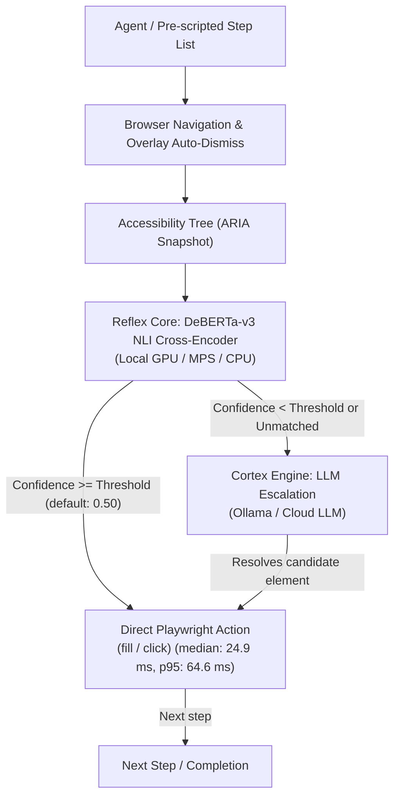

# Cognitive Browser MCP

[](https://github.com/mikita12/cognitive-browser/actions/workflows/ci.yml)
[](https://opensource.org/licenses/MIT)
[](https://www.python.org/downloads/)

Cognitive Browser is an autonomous web browser agent and Model Context Protocol (MCP) server. It executes multi-step web navigation workflows by combining a local discriminative cross-encoder (**Reflex Core**) with selective generative LLM escalation (**Cortex Engine**).

By resolving routine element interactions through Natural Language Inference (NLI) rather than streaming raw HTML or full DOM trees to generative models on every step, it minimizes prompt token overhead and reduces execution latency during repetitive interactions.

---

## Benchmark: 15-Case Web Automation Performance

> **Methodology Notice:**
> The 15 scripted tasks in this suite serve as an automated **regression benchmark** to verify routing and execution accuracy across diverse layouts, **not** as proof of general browsing competence. Upstream planning tokens (formulating the initial sequence of steps from high-level natural language goals) are **not included**. Measured on NVIDIA GeForce RTX 4070 Ti (CUDA, 12 GB VRAM). Note that for a sample size of $n = 32$ interaction steps, the 95th percentile ($p95$) is approximate. For full hardware specifications, per-task breakdowns, and token accounting definitions, read [docs/benchmark-methodology.md](docs/benchmark-methodology.md).

| Metric | Measured Absolute Value | Measurement Scope & Definition |
|---|:---:|---|
| **Task Completion** | **15 / 15 (100%)** | Full execution to completion across all 15 real-world live workflows (regression suite) |
| **Reflex Step Inference Latency (CUDA)** | **24.9 ms** (median) / **64.6 ms** (p95) | Tensor forward pass per interaction step ($n = 32$ steps, range: 5.6–95.5 ms; p95 is approximate at this sample size) |
| **Average Task Duration** | **5.37 s** | Total wall-clock time per task (browser navigation, overlays, and actions) |
| **LLM Token Consumption** | **0 tokens** (13 tasks) / **285 & 1,347 tokens** (2 tasks) | 13 tasks completed with 0 LLM tokens; 2 tasks required Cortex LLM escalation (Hacker News: 285 tok., MPK: 1,347 tok.) |

### Results & Calibration Data
- **15-Case Benchmark Details:** Empirical run logs and hardware setup in [docs/benchmark-methodology.md](docs/benchmark-methodology.md) (raw results: [`benchmarks/benchmark_15_cases_results.json`](benchmarks/benchmark_15_cases_results.json) | summary script: [`benchmarks/summarize_results.py`](benchmarks/summarize_results.py)).
- **Reflex Threshold Sweep:** Calibration metrics (precision, recall, escalation rates across thresholds 0.30–0.90) in [docs/threshold-analysis.md](docs/threshold-analysis.md) (raw sweep data: [`benchmarks/threshold_sweep_results.json`](benchmarks/threshold_sweep_results.json)).
- **Demo Recording Guide:** Instructions for recording terminal demo GIFs in [docs/demo.md](docs/demo.md).

---

## Architecture

Standard browser agents feed accessibility snapshots or raw HTML into a cloud LLM reasoning loop on every turn. Cognitive Browser divides automation into two distinct tiers:



1. **Reflex Core**: Evaluates interactive candidates using Zero-Shot Natural Language Inference (`cross-encoder/nli-deberta-v3-small`, 140M parameters) where the premise is candidate metadata (role, name, text) and the hypothesis is the user's step intent.
2. **Cortex Engine**: When confidence falls below the configured threshold (`REFLEX_CONFIDENCE_THRESHOLD`, default `0.50`) or when no suitable element is found, Cortex inspects the condensed candidate list with an LLM to resolve ambiguities.
3. **DOM Locator Strategy**:
   - Heuristic cookie and consent overlay auto-dismissal.
   - Unicode icon character normalization (`\ue000-\uf8ff` stripping).
   - Input role filtering (`require_input_only` for text fill operations).

---

## Quickstart

### 1. Installation

```bash
git clone https://github.com/mikita12/cognitive-browser.git
cd cognitive-browser

pip install -e .
playwright install chromium
```

### 2. Run as MCP Server

Add to your MCP client configuration (e.g., Claude Desktop `claude_desktop_config.json` or Antigravity `mcp_config.json`):

```json
{
  "mcpServers": {
    "cognitive-browser": {
      "command": "python",
      "args": ["-m", "cognitive_browser.mcp_server"]
    }
  }
}
```

Or run via the installed console script:
```bash
cognitive-browser
```

### 3. Run as Docker Microservice

```bash
docker compose up -d --build
```
The FastAPI REST endpoint and SSE MCP server will be accessible on `http://localhost:8000`.

---

## Router Modes: Local vs Cloud

The router selection is configured via environment variables or explicit parameters:

| Mode | Trigger | Requirements | Characteristics |
|---|---|---|---|
| **Local DeBERTa** *(Default)* | Automatic | CUDA, Apple MPS, or CPU | 100% offline, 0 LLM tokens, free. |
| **Hugging Face Inference** | `HF_TOKEN=...` | Internet connection | Serverless cross-encoder API. |
| **Cohere Rerank** | `COHERE_API_KEY=...` | Internet connection | Cloud cross-encoder reranking. |
| **Groq / OpenAI** | `GROQ_API_KEY=...` | Internet connection | Fast JSON LLM selection fallback. |

---

## MCP Tools

1. **`cognitive_browse(url, steps)`**:
   - Executes multi-step workflows autonomously with Reflex decisions and Cortex escalation.
   - Returns execution logs and structured telemetry (`total_execution_seconds`, `reflex_gpu_inference_ms`, `cortex_llm_tokens`).
2. **`get_aria_snapshot(url, max_candidates=40)`**:
   - Extracts a structured semantic Accessibility tree (filtering decorative HTML).
3. **`smart_action(url, instruction, fill_value=None)`**:
   - Evaluates and executes an atomic single action (click or fill).

---

## Limitations

- **Single Page Applications (SPAs):** Pages with slow client-side hydration, dynamic virtual scrolling, or canvas-rendered interfaces may present incomplete accessibility trees.
- **iframes and Shadow DOM:** Cross-origin iframes cannot be traversed by top-level accessibility trees without frame switching. Closed shadow roots are hidden from standard DOM traversals.
- **Authentication & CAPTCHAs:** Cognitive Browser does not solve Cloudflare challenges, Google reCAPTCHA, or multi-factor authentication puzzles.
- **Reflex Threshold Tuning:** Setting `REFLEX_CONFIDENCE_THRESHOLD` higher increases the rate of Cortex LLM escalations (spending more tokens and time in exchange for generative verification on borderline matches), while lower thresholds prioritize local zero-token execution. See [docs/threshold-analysis.md](docs/threshold-analysis.md) for empirical sweep data across thresholds.
- **Pre-scripted vs Open-Ended Navigation:** Cognitive Browser executes step sequences; formulating the high-level plan from an open-ended goal requires an upstream LLM agent.

---

## Comparison with Related Projects

| Project | Core Approach | Target Use Case | Required from User / Environment |
|---|---|---|---|
| **Cognitive Browser** | Dual-tier (local discriminative NLI cross-encoder + selective generative LLM escalation) | Form filling, structured multi-step web workflows, MCP-connected agents | Structured step instructions (`instruction` strings); local GPU/CPU or API router fallback |
| **browser-use** | Single-tier vision-language model (VLM) running an iterative ReAct perception-action loop | Open-ended exploratory web browsing from high-level natural language goals | Cloud VLM API key (e.g. OpenAI / Anthropic) with vision support |
| **Stagehand** | TypeScript framework combining Playwright with LLM-driven `act`, `extract`, and `observe` primitives | Node.js/TypeScript developer workflows and structured data extraction | LLM API key; Node.js runtime environment |
| **Playwright MCP** | Exposes granular browser tools (click, fill, navigate, snapshot) directly to an external LLM orchestrator | External LLM assistants managing their own step-by-step browser interactions | External agent / orchestrator with full conversation context management |

---

## Security

Cognitive Browser handles untrusted web content and executes browser interactions:
- **SSRF Protection:** Loopback (`127.0.0.1`, `[::1]`), private IP ranges (RFC 1918, `fc00::/7`), link-local (`fe80::/10`), IPv4-mapped IPv6, and cloud metadata endpoints (`169.254.169.254`) are blocked by default. All outgoing requests (documents, subresources, fetch/XHR, HTTP redirects, and WebSockets) are intercepted and verified via Playwright (`context.route("**/*")` and `route_web_socket`) before dispatch, while service workers are blocked (`service_workers="block"`). Due to Chromium architecture, single-hop redirects are validated and blocked before connection; see [docs/threat-model.md](docs/threat-model.md) for residual DNS rebinding and multi-hop CDP nuances. Domain allowlists can be enforced via `ALLOWED_DOMAINS`.
- **Sensitive Data Masking:** `fill_value` operations are masked (`***`) by default in logs and telemetry to prevent accidental credential leakage. Users can opt out via `DISABLE_FILL_MASKING=true`.
- **Prompt Injection from Page Content:** Untrusted webpage content and accessibility tree labels are passed to the Cortex LLM escalation tier. While inputs are length-capped and control characters are stripped (`sanitize_untrusted_text`), semantic prompt injection cannot be guaranteed to be filtered by text heuristics alone. Do not automate untrusted malicious websites without external container sandboxing.
- **API Token Authentication:** The REST API and SSE service on port 8000 support token authentication via the `API_TOKEN` environment variable. `docker-compose.yml` binds to `127.0.0.1:8000` by default. **Do not expose port 8000 to public networks without setting `API_TOKEN`**.
- For vulnerability reporting and full threat model analysis, see [SECURITY.md](SECURITY.md) and [docs/threat-model.md](docs/threat-model.md).

---

## Development & Testing

Run unit tests:
```bash
pytest tests/ -v
```

Run offline fixture benchmark:
```bash
python benchmarks/run_15_cases_benchmark.py --mode fixture --runs 2
```
