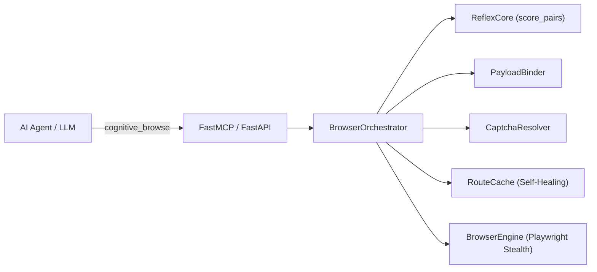

# Cognitive Browser

> **Zero-token autonomous browser agent & MCP server powered by pluggable local GPU Cross-Encoder / NLI routing (`ReflexCore`), universal cross-lingual form binding (`PayloadBinder`), Stealth Playwright (`BrowserEngine`), and self-healing `RouteCache`.**

Cognitive Browser enables AI coding assistants (Antigravity, Claude Desktop, Cursor) to navigate the web, search dynamic SPAs, and fill complex multi-field forms with **0 LLM tokens** consumed during DOM exploration and action execution.

---

## Highlights

- ⚡ **Zero-Token Autonomous Navigation:** Navigates multi-hop websites on GPU in milliseconds (~3.3ms per candidate; 400+ DOM elements evaluated in <25ms).
- 🔌 **Pluggable Neural Models (Rerankers & NLI):** Works out-of-the-box with any HuggingFace `AutoModelForSequenceClassification` — including multilingual Cross-Encoder Rerankers (`mmarco-mMiniLMv2`, `bge-reranker-v2-m3`, `gte-reranker-modernbert-base`) and NLI models (`DeBERTa-v3`, `mDeBERTa-v3`, `ModernBERT-nli`).
- 🧠 **Dictionary-Free Cross-Lingual `PayloadBinder`:** Partitions DOM controls by structural role (`textbox`, `combobox`, `checkbox`, `upload_file`) and binds arbitrary JSON payloads across languages (e.g., English keys to Polish forms or vice versa) with zero hardcoded synonym tables.
- 🚀 **Self-Healing `RouteCache`:** Learns deterministic shortcut routes in SQLite for near-instant repeat execution and automatically invalidates stale entries if a site's DOM changes.
- 🛡️ **SSRF & Security Guards:** Restricts navigation to public destinations, blocks loopback/private networks and cloud metadata APIs (`169.254.169.254`), and protects against DNS rebinding.
- 🍪 **System Cookie Sync & CAPTCHA Resolution:** Imports authenticated sessions from local Firefox profiles and integrates automated Turnstile / reCAPTCHA resolution.
- 🧩 **Strongly-Typed Clean Architecture:** Built with decoupled single-responsibility modules (`models`, `parser`, `payload`, `captcha`, `cache`, `reflex`, `orchestrator`, `browser`, `security`).

---

## Architecture Overview



For complete technical specifications, see the [Architecture & Engineering Guide](docs/architecture.md).

---

## Pluggable Model Support (`COGNITIVE_BROWSER_MODEL`)

`ReflexCore` automatically inspects `model.config.num_labels` at startup and adapts its inference head and prompt formatting:

1. **Cross-Encoder Rerankers (`num_labels = 1`, sigmoid calibration):**
   - `cross-encoder/mmarco-mMiniLMv2-L12-H384-v1` *(Default — fast, 14 languages including Polish & English)*
   - `BAAI/bge-reranker-v2-m3` *(High-accuracy multilingual reranker)*
   - `Alibaba-NLP/gte-reranker-modernbert-base` *(ModernBERT Cross-Encoder reranker)*
2. **NLI Entailment Models (`num_labels = 3`, entailment vs. contradiction softmax):**
   - `MoritzLaurer/mDeBERTa-v3-base-mnli-xnli` *(Multilingual DeBERTa-v3 NLI)*
   - `cross-encoder/nli-deberta-v3-small` *(Lightweight English DeBERTa-v3 NLI)*
   - `tasksource/ModernBERT-base-nli` *(ModernBERT NLI)*

Switch models anytime via the `COGNITIVE_BROWSER_MODEL` environment variable:
```bash
export COGNITIVE_BROWSER_MODEL="BAAI/bge-reranker-v2-m3"
```

---

## Quick Start

### 1. Installation

```bash
git clone https://github.com/mikita12/cognitive-browser.git
cd cognitive-browser
pip install -e .
playwright install chromium
```

### 2. Configure MCP Server in Antigravity / Claude Desktop

Add Cognitive Browser to your MCP client configuration (`~/.gemini/antigravity/mcp_config.json` or `claude_desktop_config.json`):

```json
{
  "mcpServers": {
    "cognitive-browser": {
      "command": "python3",
      "args": ["-m", "cognitive_browser.mcp_server"],
      "cwd": "/path/to/cognitive-browser"
    }
  }
}
```

### 3. Usage Examples

#### Single-Call Autonomous Goal Navigation:
```python
cognitive_browse(
    url="https://pl.wikipedia.org",
    goal="Wpisz w wyszukiwarkę: 'Sztuczna inteligencja' i otwórz artykuł"
)
```

#### Cross-Lingual Form Binding & File Upload:
```python
cognitive_browse(
    url="https://company.com/careers/apply",
    payload={
        "first_name": "Jan",
        "last_name": "Kowalski",
        "email": "jan@example.com",
        "cv": "/home/user/documents/cv.pdf",
        "rodo": True
    }
)
```

---

## Running the Test Suite

```bash
pytest tests/
```

All 62 automated unit and integration tests pass with comprehensive coverage across domain models, ARIA parsing, cross-lingual payload binding, CAPTCHA handling, RouteCache self-healing, and SSRF security controls.

---

## License

MIT License. See [LICENSE](LICENSE) for details.
