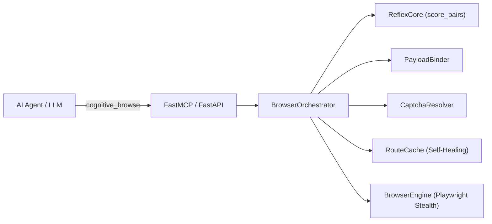

# Cognitive Browser

> **Zero-token autonomous browser agent & MCP server powered by pluggable local GPU Cross-Encoder / NLI routing (`ReflexCore`), universal cross-lingual form binding (`PayloadBinder`), Stealth Playwright (`BrowserEngine`), and self-healing `RouteCache`.**

Cognitive Browser enables AI coding assistants (Antigravity, Claude Desktop, Cursor) to navigate the web, search dynamic SPAs, and fill complex multi-field forms with **0 LLM tokens** consumed during DOM exploration and action execution.

---

## Highlights

- ⚡ **Zero-Token Autonomous Navigation:** Navigates multi-hop websites on GPU in milliseconds (~3.3ms per candidate; 400+ DOM elements evaluated in <25ms).
- 🔌 **Pluggable Neural Models (Rerankers & NLI):** Works out-of-the-box with any HuggingFace `AutoModelForSequenceClassification` — including multilingual Cross-Encoder Rerankers (`mmarco-mMiniLMv2`, `bge-reranker-v2-m3`, `gte-reranker-modernbert-base`) and NLI models (`DeBERTa-v3`, `mDeBERTa-v3`, `ModernBERT-nli`).
- 🧠 **Dictionary-Free Cross-Lingual `PayloadBinder`:** Partitions DOM controls by structural role (`textbox`, `combobox`, `checkbox`, `upload_file`) and binds arbitrary JSON payloads across languages (e.g., English keys to Polish forms or vice versa) with zero hardcoded synonym tables.
- 🚀 **Self-Healing `RouteCache`:** Learns deterministic shortcut routes in SQLite for near-instant repeat execution and automatically invalidates stale entries if a site's DOM changes.
- 🛡️ **SSRF & Security Guards:** Restricts navigation to public destinations, blocks loopback/private networks and cloud metadata APIs (`169.254.169.254`), and protects against DNS rebinding.
- 🍪 **System Cookie Sync & CAPTCHA Resolution:** Imports authenticated sessions from local Firefox profiles and integrates automated Turnstile / reCAPTCHA resolution.
- 🧩 **Strongly-Typed Clean Architecture:** Built with decoupled single-responsibility modules (`models`, `parser`, `payload`, `captcha`, `cache`, `reflex`, `orchestrator`, `browser`, `security`).

---

## Architecture Overview



For complete technical specifications, see the [Architecture & Engineering Guide](docs/architecture.md).

---

## Model Selection Guide (`COGNITIVE_BROWSER_MODEL` & `COGNITIVE_BROWSER_DEVICE`)

Cognitive Browser is **not** locked to a single model. At startup, `ReflexCore` inspects `model.config.num_labels` (or your API settings) and automatically configures the scoring head and prompt format across **3 supported model families**:

### 1. Cross-Encoder Rerankers (`num_labels = 1`, Sigmoid Calibration)
Scores `[query, element_description]` directly in a single forward pass:
- **`cross-encoder/mmarco-mMiniLMv2-L12-H384-v1`** *(Default)* — Multilingual (14+ languages including Polish & English), 470 MB. Fast on both GPU (`3.6 ms`) and CPU (`20.0 ms`).
- **`cross-encoder/ms-marco-MiniLM-L-6-v2`** — Ultra-lightweight (90 MB). Ideal for CPU-only laptops (`14.1 ms` on CPU, `2.6 ms` on GPU).
- **`jinaai/jina-reranker-v2-base-multilingual`** — Jina AI multilingual reranker (100+ languages, function-calling & code-aware). Can be run **locally** from HuggingFace or **in the cloud with 0 MB RAM/VRAM** via Jina API (`api:jina-reranker-v2-base-multilingual`).
- **`Alibaba-NLP/gte-reranker-modernbert-base`** — ModernBERT-based Cross-Encoder reranker (up to 8192 tokens).
- **`BAAI/bge-reranker-v2-m3`** — High-capacity multilingual reranker (~2.2 GB) for 8GB+ VRAM GPUs.

### 2. Zero-Shot NLI Entailment Models (`num_labels = 3`, Entailment vs. Contradiction Softmax)
Evaluates `[element_description, "This element represents, opens, or is used to {intent}."]` via NLI entailment probability:
- **`tasksource/ModernBERT-base-nli`** — ModernBERT NLI (~598 MB, `7.8 ms` on GPU).
- **`MoritzLaurer/mDeBERTa-v3-base-mnli-xnli`** — Multilingual DeBERTa-v3 NLI (100+ languages, ~1.1 GB).
- **`cross-encoder/nli-deberta-v3-small`** — Compact English DeBERTa-v3 NLI (~540 MB).

### 3. Remote Reranker API Mode (`0 MB Local VRAM / RAM`)
Offloads scoring over HTTPS to any `/v1/rerank` endpoint without loading PyTorch weights into memory:
- **`api:jina-reranker-v2-base-multilingual`** — Official **Jina AI Reranker API** (`https://api.jina.ai/v1/rerank`).
- **Custom `/v1/rerank` Endpoints** — Compatible with **Cohere Rerank**, **HuggingFace Text Embeddings Inference (TEI)**, and **vLLM `/v1/rerank`**.

---

### Live Benchmark Comparison (CPU vs. GPU vs. Cloud API)

| Model ID (`COGNITIVE_BROWSER_MODEL`) | Family | Languages | Weights Size | Local VRAM / RAM | CPU Latency *(8 cands)* | GPU Latency *(8 cands)* | Recommended Hardware |
| :--- | :---: | :---: | :---: | :---: | :---: | :---: | :--- |
| **`api:jina-reranker-v2-base-multilingual`** | Cloud API | 100+ (PL, EN, DE...) | **0 MB** | **0 MB** | ~65–120 ms *(HTTP)* | N/A *(Cloud)* | **No GPU & Low RAM** (1M free tokens at `jina.ai/reranker`) |
| **`cross-encoder/ms-marco-MiniLM-L-6-v2`** | Reranker (`1` label) | EN (+ basic Latin) | **90 MB** | ~180 MB | **14.07 ms** | **2.64 ms** | **Ultra-light CPU laptops** & fast English browsing |
| **`cross-encoder/mmarco-mMiniLMv2-L12-H384-v1`** *(Default)* | Reranker (`1` label) | 14+ (PL, EN, DE, ES...) | **470 MB** | ~480 MB | **19.96 ms** | **3.62 ms** | **Best all-around default** for both CPU & GPU |
| **`tasksource/ModernBERT-base-nli`** | NLI (`3` labels) | EN | **598 MB** | ~650 MB | 120.79 ms | **7.79 ms** | Dedicated GPU (FlashAttention-2 / ModernBERT NLI) |
| **`MoritzLaurer/mDeBERTa-v3-base-mnli-xnli`** | NLI (`3` labels) | 100+ | ~1.1 GB | ~1.2 GB | ~190 ms | ~14.5 ms | Dedicated GPU (Multilingual zero-shot NLI) |
| **`BAAI/bge-reranker-v2-m3`** | Reranker (`1` label) | 100+ | ~2.2 GB | ~2.3 GB | ~350 ms | ~18.0 ms | 8GB+ VRAM GPU |

---

### How to Switch Models & Execution Modes

#### Option A: Zero-VRAM / Low-RAM Cloud Mode via Jina Reranker API
If your computer has **no dedicated GPU** and **low RAM**, use **Jina AI's Reranker API** (`jina-reranker-v2-base-multilingual`) with **0 MB local model weights**:

1. Copy a free API key (includes **1,000,000 free tokens**, no credit card required) from **[https://jina.ai/reranker/](https://jina.ai/reranker/)**.
2. Set `JINA_API_KEY` and `COGNITIVE_BROWSER_DEVICE="api"`:
   ```bash
   export COGNITIVE_BROWSER_DEVICE="api"
   export JINA_API_KEY="jina_xxxxxxxxxxxxxxxxxxxxxxxx"
   # Optional: pick a specific Jina model (defaults to jina-reranker-v2-base-multilingual)
   export COGNITIVE_BROWSER_MODEL="api:jina-reranker-v2-base-multilingual"
   ```

> [!TIP]
> **Self-Hosted / Custom Rerank API (Cohere / TEI / vLLM):** Set `RERANK_API_URL="https://your-endpoint/v1/rerank"` and `RERANK_API_KEY="your_key"`.

#### Option B: Lightweight Local CPU Mode (No GPU Required, 100% Offline)
Run locally on any laptop CPU in **14–20 ms** without an API key:
```bash
# Ultra-light CPU (~90 MB download, ~14.1 ms latency on CPU):
export COGNITIVE_BROWSER_MODEL="cross-encoder/ms-marco-MiniLM-L-6-v2"
export COGNITIVE_BROWSER_DEVICE="cpu"

# Multilingual CPU — Polish, English, German, etc. (~470 MB download, ~20.0 ms latency on CPU):
export COGNITIVE_BROWSER_MODEL="cross-encoder/mmarco-mMiniLMv2-L12-H384-v1"
export COGNITIVE_BROWSER_DEVICE="cpu"
```

#### Option C: Local GPU Mode (CUDA / Apple Silicon MPS)
```bash
# Default Multilingual Reranker on GPU (~3.6 ms):
export COGNITIVE_BROWSER_MODEL="cross-encoder/mmarco-mMiniLMv2-L12-H384-v1"
export COGNITIVE_BROWSER_DEVICE="cuda"

# ModernBERT NLI on GPU (~7.8 ms):
export COGNITIVE_BROWSER_MODEL="tasksource/ModernBERT-base-nli"
export COGNITIVE_BROWSER_DEVICE="cuda"
```

### Configuration Environment Variables Reference

| Variable | Default | Description |
| :--- | :--- | :--- |
| `COGNITIVE_BROWSER_MODEL` *(or `REFLEX_MODEL`)* | `cross-encoder/mmarco-mMiniLMv2-L12-H384-v1` | HuggingFace model ID or `api:<model_name>` for remote reranking |
| `COGNITIVE_BROWSER_DEVICE` *(or `DEVICE`)* | Auto (`cuda` -> `mps` -> `cpu`) | Execution backend: `cuda`, `mps`, `cpu`, or `api` |
| `JINA_API_KEY` | *(unset)* | API key from [jina.ai/reranker](https://jina.ai/reranker/); automatically enables `https://api.jina.ai/v1/rerank` |
| `RERANK_API_URL` | *(unset)* | Custom `/v1/rerank` endpoint URL (Jina, Cohere, HuggingFace TEI, vLLM) |
| `RERANK_API_KEY` | *(unset)* | Bearer token for custom `RERANK_API_URL` |
| `CONFIDENCE_THRESHOLD` | `0.35` | Minimum confidence score `[0.0–1.0]` before escalating to the LLM |
| `CAPSOLVER_API_KEY` | *(unset)* | Optional CapSolver key for automated Turnstile / reCAPTCHA solving |

---

## Quick Start

### 1. Installation

```bash
git clone https://github.com/mikita12/cognitive-browser.git
cd cognitive-browser
pip install -e .
playwright install chromium
```

### 2. Configure MCP Server in Antigravity / Claude Desktop

Add Cognitive Browser to your MCP client configuration (`~/.gemini/antigravity/mcp_config.json` or `claude_desktop_config.json`):

#### Default (Auto-detects CUDA GPU / MPS / CPU):
```json
{
  "mcpServers": {
    "cognitive-browser": {
      "command": "python3",
      "args": ["-m", "cognitive_browser.mcp_server"],
      "cwd": "/path/to/cognitive-browser"
    }
  }
}
```

#### No-GPU / 0 MB RAM Mode (Jina Reranker API):
```json
{
  "mcpServers": {
    "cognitive-browser": {
      "command": "python3",
      "args": ["-m", "cognitive_browser.mcp_server"],
      "cwd": "/path/to/cognitive-browser",
      "env": {
        "COGNITIVE_BROWSER_DEVICE": "api",
        "JINA_API_KEY": "jina_your_api_key_here"
      }
    }
  }
}
```

#### Ultra-Light Local CPU Mode (~90 MB RAM):
```json
{
  "mcpServers": {
    "cognitive-browser": {
      "command": "python3",
      "args": ["-m", "cognitive_browser.mcp_server"],
      "cwd": "/path/to/cognitive-browser",
      "env": {
        "COGNITIVE_BROWSER_MODEL": "cross-encoder/ms-marco-MiniLM-L-6-v2",
        "COGNITIVE_BROWSER_DEVICE": "cpu"
      }
    }
  }
}
```

### 3. Usage Examples

#### Single-Call Autonomous Goal Navigation:
```python
cognitive_browse(
    url="https://pl.wikipedia.org",
    goal="Wpisz w wyszukiwarkę: 'Sztuczna inteligencja' i otwórz artykuł"
)
```

#### Cross-Lingual Form Binding & File Upload:
```python
cognitive_browse(
    url="https://company.com/careers/apply",
    payload={
        "first_name": "Jan",
        "last_name": "Kowalski",
        "email": "jan@example.com",
        "cv": "/home/user/documents/cv.pdf",
        "rodo": True
    }
)
```

---

## Running the Test Suite

```bash
pytest tests/
```

All 62 automated unit and integration tests pass with comprehensive coverage across domain models, ARIA parsing, cross-lingual payload binding, CAPTCHA handling, RouteCache self-healing, and SSRF security controls.

---

## License

MIT License. See [LICENSE](LICENSE) for details.
