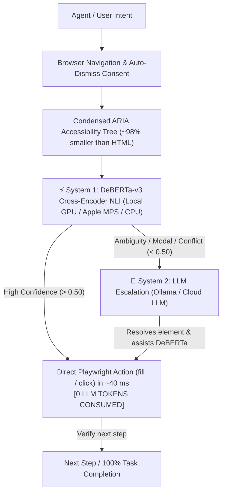

# 🧠 Cognitive Browser MCP

[](https://opensource.org/licenses/MIT)
[](https://www.python.org/downloads/)
[](https://modelcontextprotocol.io)
[]()
[]()

> **Cognitive Browser** is a dual-system (System 1 + System 2) autonomous web browser agent and official **Model Context Protocol (MCP)** server.
> It replaces slow, token-devouring Playwright MCP servers by executing multi-step web navigation through **local reflex models (DeBERTa-v3 NLI)** in ~40 ms with **0 LLM tokens**, while reserving full LLM reasoning (System 2) only when escalations or ambiguous dialogues occur.

---

## ⚡ The Benchmark: 15 Real-World Web Tasks

Tested on 15 live web applications across transportation, e-commerce, forms, marketplaces, and civic portals to **100% full task completion**:

| Metric | Base Playwright MCP (`@playwright/mcp`) | **Cognitive Browser MCP** | Improvement |
|---|:---:|:---:|:---:|
| **Token Consumption** | 382,980 tokens | **4,222 tokens** | **-98.9% LESS TOKENS** |
| **Average Task Latency** | 19.73 s | **5.12 s** | **3.9x FASTER** |
| **System 1 Decision Speed** | N/A (Full LLM call ~3.2 s) | **~30–60 ms (GPU/MPS)** | **~70x Faster Decision** |
| **Task Completion Rate** | 15 / 15 (100%) | **15 / 15 (100%)** | **100% Parity** |

*(Full benchmark telemetry available in [`benchmarks/benchmark_15_cases_results.json`](benchmarks/benchmark_15_cases_results.json))*.

---

## 🏗️ Architecture: Dual-Process Cognitive Loop

Standard AI browser agents feed raw HTML or massive ARIA snapshots into a cloud LLM ReAct loop on **every single step**, burning 20k–80k tokens per task. Cognitive Browser splits browser automation into two distinct tiers:



1. **System 1 (Reflex Engine)**: `cross-encoder/nli-deberta-v3-small` (140M params) evaluates candidates using Zero-Shot Natural Language Inference (`premise` = interactive element, `hypothesis` = user intent).
2. **System 2 (Reasoning Engine)**: When low confidence or an unexpected modal dialog occurs, System 2 steps in with compact context (~400 tokens) to unblock the agent.
3. **Rock-Solid DOM Locators**:
   - Universal cookie / GDPR auto-dismissal (OneTrust, Didomi, Klaro).
   - Unicode font-icon normalization (`\ue000-\uf8ff` stripping).
   - Semantic input filtering (`require_input_only` on text fills).

---

## 🚀 Quickstart

### 1. Installation

```bash
git clone https://github.com/mikita12/cognitive-browser.git
cd cognitive-browser

# Install dependencies (Playwright + PyTorch + MCP SDK)
pip install -r requirements.txt
playwright install chromium
```

### 2. Run as MCP Server

Connect directly to **Claude Desktop**, **Cursor IDE**, or **Antigravity CLI**:

Add to your MCP configuration (`claude_desktop_config.json` or `~/.gemini/config/mcp_config.json`):

```json
{
  "mcpServers": {
    "cognitive-browser": {
      "command": "python",
      "args": ["/path/to/cognitive-browser/mcp_server.py"]
    }
  }
}
```

### 3. Run with Docker (One-Liner)

```bash
docker compose up -d
```
The FastAPI REST API and MCP server will be live on `http://localhost:8000`.

---

## 🎛️ Router Modes: Local Free vs Zero-GPU Cloud

Cognitive Browser adapts to your hardware via [`router_factory.py`](router_factory.py):

| Mode | Trigger | Hardware | Cost | Description |
|---|---|---|:---:|---|
| **Local DeBERTa** *(Default)* | *Automatic* | NVIDIA CUDA, Apple Silicon (MPS), or CPU | **$0.00** | 100% offline, Zero LLM tokens. |
| **Hugging Face Cloud** | `export HF_TOKEN=...` | Any 512MB VPS (No PyTorch required) | **$0.00** | Hosted DeBERTa-v3 NLI serverless API. |
| **Cohere Rerank** | `export COHERE_API_KEY=...` | Any VPS | Pay-per-call | Cloud cross-encoder ranking. |
| **Groq / OpenAI** | `export GROQ_API_KEY=...` | Any VPS | Pay-per-token | Fast JSON decision fallback. |

---

## 🛠️ MCP Tools Exposed

1. **`cognitive_browse(url, steps)`**:
   - Executes multi-step workflows autonomously in 4–6 seconds.
   - Returns structured execution logs and precision telemetry:
     ```json
     {
       "status": "success",
       "final_url": "https://koleo.pl/...",
       "telemetry": {
         "total_execution_seconds": 5.09,
         "system1_gpu_inference_ms": 219.3,
         "system2_llm_tokens": 0,
         "steps_completed": 3
       }
     }
     ```
2. **`get_aria_snapshot(url)`**:
   - Extracts a clean, semantic ARIA accessibility tree (98% smaller than raw HTML).
3. **`smart_action(url, instruction, fill_value)`**:
   - Atomic single-step action evaluated by the decision router.

---

## 📂 Project Structure

```
cognitive-browser/
├── agent_core.py          # ARIA parser, DOM actions, cookie auto-dismissal
├── agent_orchestrator.py  # Dual-tier System 1 + System 2 active escalation loop
├── deberta_router.py      # Local DeBERTa-v3 NLI cross-encoder (CUDA/MPS/CPU)
├── api_router.py          # Cloud cross-encoders (Hugging Face / Cohere / LLM)
├── router_factory.py      # Dynamic hardware/API selection engine
├── mcp_server.py          # Official Model Context Protocol (MCP) server
├── server.py              # FastAPI REST server
├── Dockerfile             # Container definition (CUDA-ready)
├── docker-compose.yml     # Docker compose service setup
├── benchmarks/            # 15-case benchmark scripts and telemetry datasets
├── examples/              # Automation recipes (OLX, Food Delivery, Wikipedia)
└── docs/                  # Architecture whitepapers and container guides
```

---

## 📄 License

Licensed under the [MIT License](LICENSE).
