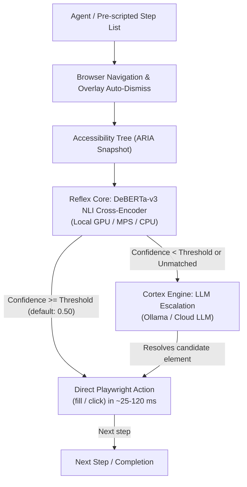

# Cognitive Browser MCP

[](https://github.com/mikita12/cognitive-browser/actions/workflows/ci.yml)
[](https://opensource.org/licenses/MIT)
[](https://www.python.org/downloads/)

Cognitive Browser is an autonomous web browser agent and Model Context Protocol (MCP) server. It executes multi-step web navigation workflows by combining a local discriminative cross-encoder (**Reflex Core**) with selective generative LLM escalation (**Cortex Engine**).

By resolving routine element interactions through Natural Language Inference (NLI) rather than streaming raw HTML or full DOM trees to generative models on every step, it minimizes prompt token overhead and reduces execution latency during repetitive interactions.

---

## Benchmark: 15-Case Web Automation Evaluation

> **Methodology Notice:**
> The metrics below reflect execution of pre-scripted multi-step workflows across 15 web applications. Upstream planning tokens (the initial formulation of the step sequence by an external agent) are **not included**. Baseline figures for standard Playwright MCP are derived from an analytical ReAct simulation model. For complete hardware specifications, model configurations, and token accounting rules, read [docs/benchmark-methodology.md](docs/benchmark-methodology.md).

| Metric | Simulated Baseline ReAct Agent | Cognitive Browser (Reflex + Cortex) | Measured Difference |
|---|:---:|:---:|:---:|
| **Interaction Token Consumption** | ~372,073 tokens | 4,300 tokens | 98.8% token reduction on routine steps |
| **Average Task Duration** | ~18.12 s (simulated network) | 5.37 s (local CUDA GPU) | ~3.4x faster step execution via local routing |
| **Reflex Core Decision Latency** | N/A (Cloud LLM call ~2–4 s) | ~6–95 ms/step (~63.1 ms/task on CUDA) | Sub-second local discriminative decision loop |
| **Task Completion on Test Set** | 15 / 15 | 15 / 15 | 100% completion across all 15 live workflows |

*(Benchmark run data available in [`benchmarks/benchmark_15_cases_results.json`](benchmarks/benchmark_15_cases_results.json))*.

---

## Architecture

Standard browser agents feed accessibility snapshots or raw HTML into a cloud LLM reasoning loop on every turn. Cognitive Browser divides automation into two distinct tiers:



1. **Reflex Core**: Evaluates interactive candidates using Zero-Shot Natural Language Inference (`cross-encoder/nli-deberta-v3-small`, 140M parameters) where the premise is candidate metadata (role, name, text) and the hypothesis is the user's step intent.
2. **Cortex Engine**: When confidence falls below the configured threshold (`REFLEX_CONFIDENCE_THRESHOLD`, default `0.50`) or when no suitable element is found, Cortex inspects the condensed candidate list with an LLM to resolve ambiguities.
3. **DOM Locator Strategy**:
   - Heuristic cookie and consent overlay auto-dismissal.
   - Unicode icon character normalization (`\ue000-\uf8ff` stripping).
   - Input role filtering (`require_input_only` for text fill operations).

---

## Quickstart

### 1. Installation

```bash
git clone https://github.com/mikita12/cognitive-browser.git
cd cognitive-browser

pip install -e .
playwright install chromium
```

### 2. Run as MCP Server

Add to your MCP client configuration (e.g., Claude Desktop `claude_desktop_config.json` or Antigravity `mcp_config.json`):

```json
{
  "mcpServers": {
    "cognitive-browser": {
      "command": "python",
      "args": ["-m", "cognitive_browser.mcp_server"]
    }
  }
}
```

Or run via the installed console script:
```bash
cognitive-browser
```

### 3. Run as Docker Microservice

```bash
docker compose up -d --build
```
The FastAPI REST endpoint and SSE MCP server will be accessible on `http://localhost:8000`.

---

## Router Modes: Local vs Cloud

The router selection is configured via environment variables or explicit parameters:

| Mode | Trigger | Requirements | Characteristics |
|---|---|---|---|
| **Local DeBERTa** *(Default)* | Automatic | CUDA, Apple MPS, or CPU | 100% offline, 0 LLM tokens, free. |
| **Hugging Face Inference** | `HF_TOKEN=...` | Internet connection | Serverless cross-encoder API. |
| **Cohere Rerank** | `COHERE_API_KEY=...` | Internet connection | Cloud cross-encoder reranking. |
| **Groq / OpenAI** | `GROQ_API_KEY=...` | Internet connection | Fast JSON LLM selection fallback. |

---

## MCP Tools

1. **`cognitive_browse(url, steps)`**:
   - Executes multi-step workflows autonomously with Reflex decisions and Cortex escalation.
   - Returns execution logs and structured telemetry (`total_execution_seconds`, `reflex_gpu_inference_ms`, `cortex_llm_tokens`).
2. **`get_aria_snapshot(url, max_candidates=40)`**:
   - Extracts a structured semantic Accessibility tree (filtering decorative HTML).
3. **`smart_action(url, instruction, fill_value=None)`**:
   - Evaluates and executes an atomic single action (click or fill).

---

## Limitations

- **Single Page Applications (SPAs):** Pages with slow client-side hydration, dynamic virtual scrolling, or canvas-rendered interfaces may present incomplete accessibility trees.
- **iframes and Shadow DOM:** Cross-origin iframes cannot be traversed by top-level accessibility trees without frame switching. Closed shadow roots are hidden from standard DOM traversals.
- **Authentication & CAPTCHAs:** Cognitive Browser does not solve Cloudflare challenges, Google reCAPTCHA, or multi-factor authentication puzzles.
- **High-Confidence Reflex Errors:** As a cross-encoder model, DeBERTa may occasionally assign high confidence to an incorrect element if multiple elements share ambiguous naming. Setting `REFLEX_CONFIDENCE_THRESHOLD` higher (e.g. `0.65`) encourages safer escalation to Cortex.
- **Pre-scripted vs Open-Ended Navigation:** Cognitive Browser executes step sequences; formulating the high-level plan from an open-ended goal requires an upstream LLM agent.

---

## Comparison with Related Projects

| Project | Approach | Best For | Trade-offs |
|---|---|---|---|
| **Cognitive Browser** | Dual-tier (local NLI cross-encoder + selective LLM escalation) | Cost-sensitive workflows, high-throughput form filling, structured MCP tools | Requires structured steps; no native vision model |
| **browser-use** | Full cloud vision LLM in an open-ended ReAct loop | Complex, visually-guided exploratory navigation | High token consumption and cost per task; higher step latency |
| **Stagehand** | TypeScript SDK with targeted AI extraction and action primitives | Node.js developers building custom scraping and automation scripts | Generative LLM invocations per action; requires API keys |
| **Playwright MCP** | Low-level browser automation tools called individually by agent | Granular control by an external LLM orchestrator | Accumulates large conversation context over multi-turn tasks |

---

## Security

Cognitive Browser handles untrusted web content and executes browser interactions:
- **SSRF Protection:** By default, private IP ranges (RFC 1918), loopback addresses, and cloud metadata endpoints (`169.254.169.254`) are blocked.
- **Sensitive Data Masking:** Input values in `fill_value` operations can be masked in logs and telemetry to prevent credential exposure.
- For vulnerability reporting and full threat model analysis, see [SECURITY.md](SECURITY.md) and [docs/threat-model.md](docs/threat-model.md).

---

## Development & Testing

Run unit tests:
```bash
pytest tests/ -v
```

Run offline fixture benchmark:
```bash
python benchmarks/run_15_cases_benchmark.py --mode fixture --runs 2
```
