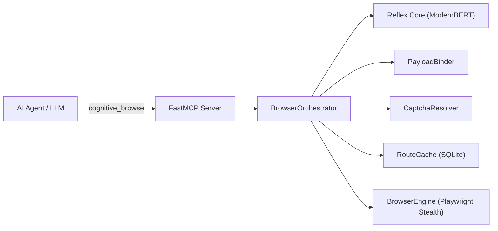

# Cognitive Browser

> **High-speed, zero-token autonomous web browser powered by local GPU Cross-Encoder (Reflex Core), Stealth BrowserEngine, and RouteCache.**

Cognitive Browser enables AI coding assistants (Antigravity, Claude, Cursor) to navigate the web autonomously with **0 LLM tokens** consumed during DOM exploration, filling inputs, resolving CAPTCHAs, and clicking multi-hop routes.

---

## Highlights

- ⚡ **Zero-Token Autonomous Navigation:** Navigates multi-hop websites using local ModernBERT / DeBERTa Cross-Encoder models in milliseconds (~3.3ms per element).
- 🧠 **Universal Payload Binding:** Semantically binds arbitrary JSON form dictionaries (names, emails, resumes, CVs, filters) to DOM inputs without hardcoded CSS selectors.
- 🚀 **RouteCache:** Automatically learns direct shortcut routes to pages and actions, delivering near-instant sub-15ms repeat interactions.
- 🛡️ **SSRF & Security Guards:** Restricts navigation to public destinations, blocks cloud metadata APIs (`169.254.169.254`), and protects against DNS rebinding.
- 🍪 **System Cookie Sync:** Seamlessly imports authenticated sessions from your local Firefox profile or cookie files to bypass Cloudflare and auth walls.
- 🧩 **Clean Modular Architecture:** Built with decoupled single-responsibility modules (`parser`, `payload`, `captcha`, `cache`, `reflex`, `orchestrator`, `browser`).

---

## Architecture Overview



For complete technical specifications, see the [Architecture & Engineering Guide](docs/architecture.md).

---

## Quick Start

### 1. Installation

```bash
git clone https://github.com/mikita12/cognitive-browser.git
cd cognitive-browser
pip install -e .
playwright install chromium
```

### 2. Configure MCP Server in Antigravity / Claude Desktop

Add Cognitive Browser to your MCP client configuration (`~/.gemini/antigravity-cli/mcp_config.json` or `claude_desktop_config.json`):

```json
{
  "mcpServers": {
    "cognitive-browser": {
      "command": "python3",
      "args": ["-m", "cognitive_browser.mcp_server"],
      "cwd": "/path/to/cognitive-browser"
    }
  }
}
```

### 3. Usage Examples

#### Single-Call Autonomous Goal Navigation:
```python
cognitive_browse(
    url="https://www.gov.pl",
    goal="założenie firmy jednoosobowej formularz wniosku"
)
```

#### Universal Form & File Upload:
```python
cognitive_browse(
    url="https://company.com/careers/apply",
    payload={
        "full_name": "Jan Kowalski",
        "email": "jan@example.com",
        "cv_file": "/home/user/documents/cv.pdf"
    }
)
```

---

## Running the Test Suite

```bash
pytest tests/
```

All 60 automated tests pass with comprehensive coverage across parsing, payload binding, CAPTCHA handling, RouteCache, and security controls.

---

## License

MIT License. See [LICENSE](LICENSE) for details.
