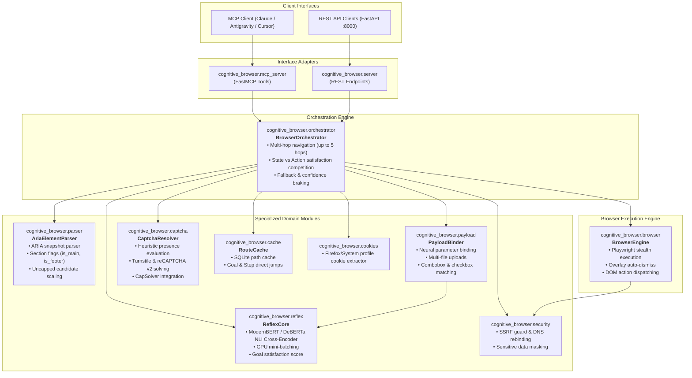

# Cognitive Browser - System Architecture & Engineering Guide

## 1. Executive Summary & Design Philosophy

**Cognitive Browser** is a high-speed, zero-token browser automation system designed for autonomous AI agents. Unlike traditional LLM-based web browsing approaches that stream multi-megabyte raw HTML snapshots into external LLM context windows (costing tokens, latency, and losing spatial coherence), Cognitive Browser executes navigation loops entirely locally on GPU:

1. **Zero-Token Autonomous Navigation:** The agent issues a single high-level intent (e.g. `cognitive_browse(url="...", goal="Find contact email and pricing")`).
2. **Local ModernBERT / DeBERTa-v3 Cross-Encoder (Reflex Core):** Evaluates semantic relevance between intent and candidate interactive elements directly on local GPU in milliseconds (~3.3 ms per element; 1000 elements processed in under 3.5s).
3. **RouteCache:** Caches deterministic execution paths in SQLite; recurring tasks complete with 0ms neural latency.
4. **Stealth & Bot Resistance:** Integrates passive CAPTCHA heuristics, CapSolver automated resolution, and authenticated Firefox/System cookie synchronization.
5. **Agent-in-the-Loop Escalation:** Escalates back to the orchestrating LLM *only* when local confidence falls below calibrated thresholds or explicit ambiguity is detected.

---

## 2. Component Pipeline & Architecture Diagram

---

## 3. Core Modules & Responsibilities

### 3.0 [`cognitive_browser.models`](../cognitive_browser/models.py)
- **Role:** Strongly-typed domain contracts shared across all layers with dictionary-compatibility mixins for zero-friction JSON/MCP serialization.
- **Key Contracts:**
  - `CandidateElement`: Normalized interactive DOM node (`ref`, `role`, `name`, `context`, `section`, `nth`, `url`) with `format_for_model()`.
  - `ActionCommand`: Unified command contract (`action`, `target`, `role`, `name`, `nth`, `value`, `files`, `confidence`, `source`).
  - `PageState` & `StepResult`: Structured page snapshot and step telemetry records.

### 3.1 [`cognitive_browser.parser.AriaElementParser`](../cognitive_browser/parser.py)
- **Role:** Extracts interactive `CandidateElement` instances from Playwright ARIA snapshots.
- **Key Capabilities:**
  - Fast regex-based parsing of ARIA tree YAML (`- role "name"`).
  - PUA icon character cleaning (`\ue000-\uf8ff`) to prevent token pollution.
  - Section context flags: distinguishes elements inside `<main>`, `<article>`, `<header>`, and `<footer>` (`is_main`, `is_footer`, `is_header`).
  - Scalability: Supports 1,000+ candidates without artificial cutoffs; handles large infinite-scroll pages seamlessly.

### 3.2 [`cognitive_browser.payload.PayloadBinder`](../cognitive_browser/payload.py)
- **Role:** Maps arbitrary structured JSON payload dictionaries to DOM elements using structural role partitioning and neural cross-encoding (`score_pairs()`).
- **Key Capabilities:**
  - Matches keys across languages (e.g. `first_name` -> `Imię`, `imie_i_nazwisko_klienta` -> `Customer name`) to candidate form fields (`textbox`, `combobox`, `checkbox`, `button`) without hardcoded synonym dictionaries.
  - Distinguishes file upload inputs (`file_paths`) and boolean toggles from text/select inputs.
  - Solves 1-to-1 greedy bipartite matching and orders resulting `ActionCommand` objects top-to-bottom by DOM index.

### 3.3 [`cognitive_browser.captcha.CaptchaResolver`](../cognitive_browser/captcha.py)
- **Role:** Automated CAPTCHA detection and third-party solving (CapSolver).
- **Key Capabilities:**
  - `evaluate_presence(...)`: Dual heuristic and semantic check. Differentiates passive legal footers ("Protected by reCAPTCHA") from active challenge screens.
  - Detects Cloudflare Turnstile `cf-turnstile` wrappers and reCAPTCHA v2 iframe tokens.
  - Integrates with CapSolver API asynchronously; falls back gracefully when API keys are absent.

### 3.4 [`cognitive_browser.cache.RouteCache`](../cognitive_browser/cache.py)
- **Role:** Persistent SQLite cache storing successful navigation decisions with automatic self-healing (`invalidate()`).
- **Key Capabilities:**
  - Indexed by `(page_url, instruction)` or `(page_url, "GOAL::" + goal)`.
  - Enables instant direct jumps to target URLs or interactive elements for routine queries, dropping latency to <15ms.

### 3.5 [`cognitive_browser.reflex.ReflexCore`](../cognitive_browser/reflex.py)
- **Role:** Model-agnostic semantic decision core supporting Cross-Encoder Rerankers (`num_labels = 1`, e.g., `mmarco-mMiniLMv2-L12-H384-v1`, `ms-marco-MiniLM-L-6-v2`, `bge-reranker-v2-m3`), NLI Entailment models (`num_labels = 3`, e.g., `ModernBERT-base-nli`, `mDeBERTa-v3-base-mnli-xnli`), and 0-VRAM Remote Reranker APIs (`api:jina-reranker-v2-base-multilingual` via `/v1/rerank`).
- **Key Capabilities:**
  - Single centralized GPU/CPU/API mini-batch inference method (`score_pairs()`) with length-sorted batching and multi-query API grouping (`_score_pairs_api()`).
  - Page goal satisfaction scoring: breaks long page text into sliding semantic chunks and scores content match.
  - State vs Action Competition: If page satisfaction rate exceeds action candidate confidence, the agent stops navigating and extracts the content immediately.
  - Calibration: Calibrated confidence threshold (0.35 - 0.55) to trigger Agent-in-the-Loop escalation when ambiguous.

### 3.6 [`cognitive_browser.orchestrator.BrowserOrchestrator`](../cognitive_browser/orchestrator.py)
- **Role:** Unified state machine and concurrency-safe loop coordinator (`asyncio.Lock`).
- **Key Capabilities:**
  - Consolidates multi-hop autonomous exploration (`browse(goal=...)`), planned step execution (`browse(steps=[...])`), and universal parameter binding (`browse(payload=...)`).
  - Manages cookie context synchronization, overlay auto-dismissal, CAPTCHA resolution, RouteCache self-healing, and deep-chunk ARIA content extraction.
  - Decouples server interfaces (FastMCP, FastAPI) from browser automation internals.

### 3.7 [`cognitive_browser.browser.BrowserEngine`](../cognitive_browser/browser.py)
- **Role:** Pure Playwright execution driver decoupled from neural inference.
- **Key Capabilities:**
  - Stealth flags (`navigator.webdriver` spoofing, realistic client hints).
  - Deterministic overlay auto-dismissal for standard cookie banners and privacy dialogs.
  - Unified `execute(page, command: ActionCommand)` entrypoint for clicks, text typing, combobox selection, checkbox toggling, and file uploads.
  - File upload path validation enforcing `UPLOAD_ALLOWED_DIRS` via `os.path.realpath` (rejects non-existent files, directories, symlink escapes, and path traversal with `SecurityError`).

### 3.8 [`cognitive_browser.security`](../cognitive_browser/security.py), [`server.py`](../cognitive_browser/server.py) & [`cookies.py`](../cognitive_browser/cookies.py)
- **Security:** Strict URL validation, asynchronous DNS resolution in route interceptors, DNS rebinding mitigation, loopback/cloud-metadata blocking, and sensitive data masking in telemetry.
- **REST API:** FastAPI application secured with strict `Authorization: Bearer <token>` (`API_TOKEN`), configurable CORS allowlist (`CORS_ALLOWED_ORIGINS`), and opt-in container sandbox flags (`COGNITIVE_BROWSER_NO_SANDBOX`).
- **Cookies:** Reads local Firefox SQLite databases or exported JSON cookie jars to import authenticated sessions directly into browser context (disabled by default; requires `--enable-cookies`).

---

## 4. Test Verification & Code Quality

The entire architecture is verified by a comprehensive automated test suite (`pytest tests/`):
- **Parser Tests:** ARIA snapshot parsing, context resolution, PUA icon stripping.
- **Payload Tests:** Neural parameter binding, file uploads, combobox selection.
- **Captcha Tests:** Active challenge detection, passive footer filtering, mock solving.
- **Orchestrator & MCP Tests:** High-confidence autonomous paths, escalation flows, smart actions.
- **Security Tests:** SSRF guards, private IP blocking, redirect hop limit enforcement.
- **Calibration Tests:** Mini-batching on large candidate pools (1000+ items), adversarial intent suppression.
