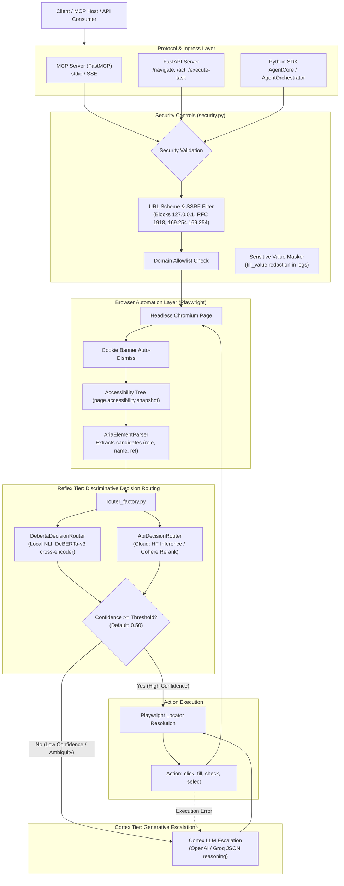

# Architecture Overview

Cognitive Browser is a hybrid web automation framework designed to minimize latency and generative token consumption. Rather than streaming the full DOM or accessibility tree to a large language model on every action turn, it delegates element selection to a discriminative cross-encoder (**Reflex Core**) and only escalates to a generative LLM (**Cortex Engine**) when confidence is insufficient or when navigation errors arise.

---

## Architectural Diagram

---

## Key Components

### 1. Ingress & Protocols
- **MCP Server** (`cognitive_browser/mcp_server.py`): Implements Model Context Protocol tools (`cognitive_browse`, `smart_action`, `get_aria_snapshot`). Operates via standard I/O or Server-Sent Events (SSE).
- **REST API** (`cognitive_browser/server.py`): High-throughput FastAPI endpoints for containerized and headless deployment.
- **Python Library** (`AgentCore`, `AgentOrchestrator`): Direct programmatic orchestration interface.

### 2. Security Controls (`cognitive_browser/security.py`)
- **URL Validation & SSRF Prevention**: Enforces `http` and `https` schemes; strictly blocks loopback addresses (`127.0.0.0/8`), private networks (RFC 1918, RFC 4193), and cloud metadata endpoints (`169.254.169.254`) by default.
- **Domain Allowlisting**: Optional restriction of agent navigation via `COGNITIVE_BROWSER_ALLOWED_DOMAINS`.
- **Sensitive Data Masking**: Automatically masks passwords, API tokens, and credentials in task execution logs and traces.

### 3. DOM & Accessibility Parsing (`cognitive_browser/agent_core.py`)
- Traverses Playwright's `accessibility.snapshot()` hierarchy.
- Identifies actionable interactive elements (roles: `button`, `link`, `textbox`, `searchbox`, `combobox`, `checkbox`, `menuitem`).
- Assigns stable virtual references (`aria-0`, `aria-1`, ...) to keep prompt payloads minimal.

### 4. Reflex Core (`cognitive_browser/deberta_router.py`)
- Formulates target selection as a Natural Language Inference (NLI) problem:
  - **Premise**: `Interactive web element: role: button, name: 'Submit Order'`.
  - **Hypothesis**: `This element represents, opens, or is used to complete checkout`.
- Computes softmax probabilities over Entailment vs. Contradiction logits.
- Zero generative LLM tokens consumed; executes in ~25–120 ms on local GPU.

### 5. Cortex Engine Escalation (`cognitive_browser/agent_orchestrator.py`)
- Triggered when:
  1. Reflex confidence score is below the configured threshold (`COGNITIVE_BROWSER_CONFIDENCE_THRESHOLD`, default: `0.50`).
  2. Element interaction fails during Playwright execution.
  3. Action requires multi-hop reasoning or text generation not expressible via single-step element selection.
- Formulates a compact JSON prompt for a fast LLM (e.g., GPT-4o-mini, Groq Llama 3.3).
