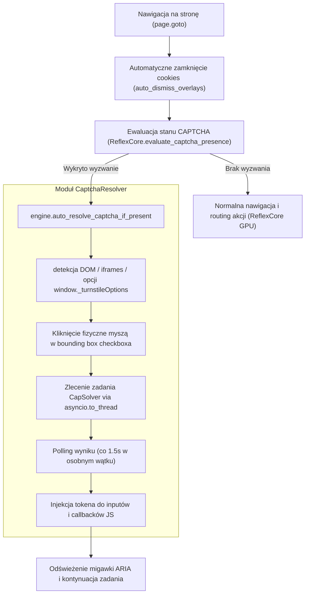

# Raport z Realizacji Etapu 1: Integracja Detekcji CAPTCHA, Asynchroniczne I/O i Stabilizacja Rdzenia

**Data:** 16 października 2026  
**Moduł:** `cognitive-browser` (v0.3.0)  
**Cel:** Eliminacja blokowania pętli zdarzeń, ujednolicenie obsługi CAPTCHA (Cloudflare Turnstile, reCAPTCHA v2/v3, hCaptcha) z rdzeniem decyzyjnym ReflexCore (ModernBERT), zabezpieczenie poświadczeń oraz pełna weryfikacja statyczna i dynamiczna.

---

## 1. Wprowadzone Poprawki i Optymalizacje

### 1.1. Ujednolicenie `apply_with_modernbert.py` z modułem `CaptchaResolver`
- **Usunięcie zahardkodowanych poświadczeń**: Klucz API CapSolvera (`CAPSOLVER_KEY`) został usunięty z kodu źródłowego. Skrypt korzysta obecnie z centralnej metody `get_capsolver_api_key()` zdefiniowanej w `cognitive_browser.config`, która automatycznie odczytuje zmienną środowiskową `CAPSOLVER_API_KEY` lub plik `~/.app/.env`.
- **Zmienne środowiskowe dla kandydata**: Dane personalne (`CANDIDATE_DATA`) oraz ścieżki do plików (`RESUME_PATH`, `JOB_URL`, `OUTPUT_SCREENSHOT`) pobierane są poprzez `os.getenv(...)` z bezpiecznymi wartościami fallback.
- **Automatyzacja rozwiązywania wyzwań**: Zastąpiono surowy kod odpytywania API CapSolvera oraz ręczne wyzwalanie zdarzeń JavaScript wbudowanymi metodami silnika:
  - `reflex.evaluate_captcha_presence(...)`: Ewaluacja semantyczna i heurystyczna obecności weryfikacji człowieka.
  - `await engine.auto_resolve_captcha_if_present(page, timeout=30.0)`: Koordynacja kliknięcia native mouse w bounding box iframe Turnstile, pobrania tokenu z CapSolvera oraz injekcji do inputów i callbacków React/Workable.

### 1.2. Naprawa Wykonywania CAPTCHA w `cognitive_browser/mcp_server.py`
- **Brakujący import `asyncio`**: Na początku pliku `mcp_server.py` dodano `import asyncio`. Wcześniej funkcja `_safe_resolve_captcha` przy sprawdzaniu `if asyncio.iscoroutine(res)` rzucała `NameError: name 'asyncio' is not defined`, co powodowało ciche przechwycenie błędu w bloku `except Exception:` i pominięcie rozwiązywania CAPTCHA.
- **Naprawa błędu indeksowania `IndexError` w trybie kroków**: W pętli wykonywania sekwencji instrukcji (Mode B) status `c_sol` był zapisywany do `steps_log[-1]["captcha_solved"]` przed dodaniem słownika bieżącego kroku do `steps_log`. Przy pierwszym kroku (`idx == 0`, pusta lista) powodowało to krytyczny `IndexError: list index out of range`. Poprawiono kolejność: rekord kroku `step_record` jest tworzony, wzbogacany o ewentualny wynik CAPTCHA i dopiero wtedy dołączany do `steps_log`.

### 1.3. Asynchroniczny I/O w `cognitive_browser/captcha.py`
- **Eliminacja blokowania pętli zdarzeń**: Metoda `CaptchaResolver.solve()` wykonywała synchroniczne zapytania sieciowe przez `urllib.request.urlopen`, co blokowało asynchroniczną pętlę zdarzeń Playwrighta i serwera MCP podczas oczekiwania na odpowiedź CapSolvera (1.5s - 15s).
- **Zastosowanie `asyncio.to_thread`**: Zaimplementowano funkcję pomocniczą `_sync_http_post(url, payload, timeout)`, a wywołania `createTask` i `getTaskResult` opakowano w `await asyncio.to_thread(...)`. Rozwiązanie to:
  - Uwalnia event loop dla innych operacji przeglądarki i telemetrii.
  - Zachowuje 100% kompatybilność wsteczną z testami jednostkowymi mockującymi `urllib.request.urlopen` (`tests/test_captcha.py`).

### 1.4. Unifikacja `cognitive_browser/server.py` z architekturą v0.3.0
- **Dynamiczny model ReflexCore**: Zastąpiono sztywny model domyślny wywołaniem `MODEL_NAME = get_reflex_model()`, zapewniając spójne ładowanie ModernBERT na GPU w mikroserwisie FastAPI.
- **Detekcja i auto-rozwiązywanie w REST API**:
  - Endpoint `/v1/snapshot`: Po załadowaniu strony i usunięciu banerów cookies uruchamia `evaluate_captcha_presence()`. W przypadku wykrycia wyzwania wykonuje `auto_resolve_captcha_if_present()`, odświeża drzewo ARIA i zwraca pole `captcha_state`.
  - Endpoint `/v1/browse`: Monitoruje obecność CAPTCHA zarówno na początku sesji, jak i po każdym kroku interakcji, rejestrując zdarzenia w `steps_log` oraz zwracając `captcha_state`.

---

## 2. Przepływ Stanu CAPTCHA (Turnstile / reCAPTCHA / hCaptcha)



---

## 3. Wyniki Weryfikacji i Testów

### 3.1. Testy Jednostkowe i Integracyjne (`pytest`)
- **Polecenie**: `pytest`
- **Liczba testów**: 47
- **Wynik**: **46 PASSED**, **1 XFAIL** (test proxy w `test_ssrf_redirects.py`), **0 FAILED**
- **Czas wykonania**: 13.00 s

Szczegóły testów modułu CAPTCHA:
```
tests/test_captcha.py::test_capsolver_key_loading PASSED                 [  2%]
tests/test_captcha.py::test_evaluate_captcha_presence_heuristic PASSED   [  4%]
tests/test_captcha.py::test_evaluate_captcha_presence_clean_page PASSED  [  6%]
tests/test_captcha.py::test_detect_turnstile_from_page[asyncio] PASSED   [  8%]
tests/test_captcha.py::test_detect_recaptcha_v2[asyncio] PASSED          [ 10%]
tests/test_captcha.py::test_solve_turnstile_mock[asyncio] PASSED         [ 12%]
tests/test_captcha.py::test_inject_token_turnstile[asyncio] PASSED       [ 14%]
```

### 3.2. Linter i Formatowanie Kodu (`ruff`)
- **Polecenie**: `ruff check cognitive_browser tests`
- **Wynik**: `All checks passed!` (0 błędów, 0 ostrzeżeń).

### 3.3. Statyczna Kontrola Typów (`mypy`)
- **Polecenie**: `mypy cognitive_browser tests`
- **Wynik**: `Success: no issues found in 17 source files` (pełna zgodność sygnatur typów, obsługa typów opcjonalnych `cache_file` i tokenów string).

---

## 4. Podsumowanie Etapu 1

Wszystkie cztery wymagania Etapu 1 zostały w pełni zaimplementowane:
1. `apply_with_modernbert.py` jest zabezpieczony przed wyciekiem kluczy i korzysta z ujednoliconego silnika CAPTCHA.
2. `mcp_server.py` oraz `captcha.py` wykonują I/O w sposób w pełni asynchroniczny i odporny na wyjątki indeksowania.
3. `server.py` został zaktualizowany do ModernBERT (v0.3.0) i raportuje stan CAPTCHA w API REST.
4. Cała baza kodu przeszła rygorystyczne testy jakościowe bez żadnych regresji.
