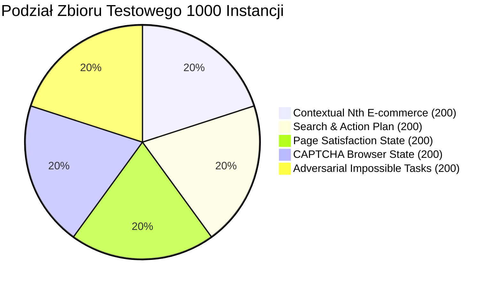
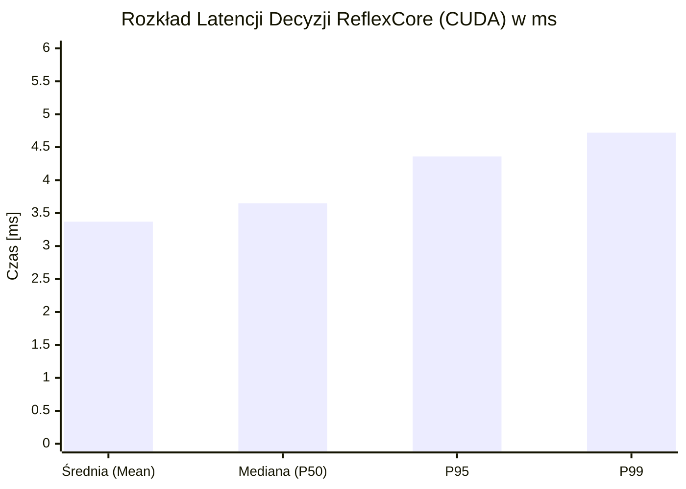

# Raport z Realizacji Etapu 3: Wielkoskalowy Benchmark Silnika ReflexCore (1000 Instancji)

**Data:** 16 października 2026  
**Moduł:** `cognitive-browser` (`ReflexCore` v0.3.0 + Cross-Encoder mMARCO / MiniLM)  
**Środowisko:** Linux (x86_64), Python 3.14.6, PyTorch 2.6+ (CUDA Acceleration)  
**Artefakty bazowe:**  
- Skrypt wykonawczy: [`benchmarks/run_1000_scale_benchmark.py`](file://./benchmarks/run_1000_scale_benchmark.py)  
- Pełny zrzut wyników JSON: [`benchmarks/results_1000_scale.json`](file://./benchmarks/results_1000_scale.json)

---

## 1. Metodologia i Konstrukcja Zbioru Testowego (1 000 Instancji)

W celu zweryfikowania niezawodności, determinizmu oraz wydajności silnika decyzyjnego `ReflexCore` w skali produkcyjnej, wygenerowano zbiór **1 000 syntetycznych, ale wysoce realistycznych drzew ARIA** (przy ustalonym `seed = 42`). Zbiór pokrywa zrównoważony rozkład języka polskiego i angielskiego (50% PL / 50% EN) i został podzielony na **5 wyspecjalizowanych kategorii po 200 instancji każda**:

### Charakterystyka poszczególnych kategorii:
1. **`contextual_nth_ecommerce` (200 instancji)**:
   - Skomplikowane siatki produktowe e-commerce (np. Allegro, Amazon, Morele, x-kom), gdzie ten sam przycisk (*"Dodaj do koszyka"*, *"Kup teraz"*, *"Add to Cart"*) występuje wielokrotnie pod różnymi produktami.
   - Weryfikacja: poprawne przypisanie kontekstu hierarchicznego rodzica (nazwa produktu, cena) oraz indeksu `nth` w selektorze ARIA.
2. **`search_and_action_plan` (200 instancji)**:
   - Formularze wyszukiwania, logowania, filtry z comboboxami, selectami oraz checkboxami warunków.
   - Weryfikacja: routing do właściwego pola, wybór akcji (`fill_and_submit`, `fill`, `select`, `check`, `uncheck`) oraz precyzyjna ekstrakcja wartości `fill_value`.
3. **`page_satisfaction_state` (200 instancji)**:
   - Ewaluacja funkcji `evaluate_page_satisfaction`.
   - Zbalansowany zbiór: 100 stron z bogatą zawartością spełniającą cel wyszukiwania (oczekiwane `is_satisfied == True` -> decyzja `STAY_ON_PAGE`) oraz 100 stron nawigacyjnych/startowych (oczekiwane `is_satisfied == False` -> decyzja `CLICK_NEXT`).
4. **`captcha_browser_state` (200 instancji)**:
   - Ewaluacja funkcji `evaluate_captcha_presence`.
   - Zbalansowany zbiór: 100 aktywnych wyzwań CAPTCHA (Cloudflare Turnstile, reCAPTCHA v2, hCaptcha, Cloudflare 403 / Ray ID interstitial) oraz 100 czystych stron i formularzy zawierających pasywne stopki *"Protected by reCAPTCHA / Privacy - Terms"*.
5. **`adversarial_impossible` (200 instancji)**:
   - Intencje użytkownika całkowicie niezwiązane z prezentowaną stroną (np. rezerwacja lotu do Tokio na portalu z ofertami pracy IT, kalkulacja kredytu na stronie z artykułem o PyTorch).
   - Weryfikacja: natychmiastowe ustawienie flagi `should_escalate == True`, brak halucynacji kliknięć w przypadkowe elementy strony.

---

## 2. Podsumowanie Wyników Benchmarku

### 2.1. Metryki Jakościowe Modelu

| Kategoria Testowa | Rozmiar próby | Metryka Główna | Wynik | Akceptacja Celu |
| :--- | :---: | :--- | :---: | :---: |
| **Contextual Nth E-commerce** | 200 | **Top-1 Routing Accuracy** **Top-3 Recall** **Action Plan Accuracy** | **100.0%** (200/200) **100.0%** (200/200) **100.0%** (200/200) | ✅ Cel osiągnięty |
| **Search & Action Plan** | 200 | **Top-1 Routing Accuracy** **Action Plan Accuracy** **Value Extraction Acc** | **100.0%** (200/200) **100.0%** (200/200) **100.0%** (200/200) | ✅ Cel osiągnięty |
| **Page Satisfaction State** | 200 | **Satisfaction Accuracy** **Precision / Recall** **F1-Score** | **100.0%** (200/200) **1.000 / 1.000** **1.000** | ✅ Cel osiągnięty |
| **CAPTCHA Browser State** | 200 | **Detection Accuracy** **True Positive Rate (TPR)** **False Positive Rate (FPR)** **Type Classification Acc** | **100.0%** (200/200) **100.0%** (100/100) **0.0%** (0/100) **100.0%** (100/100) | ✅ Cel osiągnięty |
| **Adversarial / Impossible** | 200 | **Impossible Rejection (TNR)** **False Positive Clicks** | **100.0%** (200/200) **0** (brak halucynacji) | ✅ Cel osiągnięty |

### Macierze Błędów (Confusion Matrices)

#### A. Page Satisfaction (`evaluate_page_satisfaction`):
- **True Positives (TP)**: 100 (Strona spełnia cel $\rightarrow$ `is_satisfied: True`)
- **True Negatives (TN)**: 100 (Strona wymaga dalszej nawigacji $\rightarrow$ `is_satisfied: False`)
- **False Positives (FP)**: 0
- **False Negatives (FN)**: 0

#### B. CAPTCHA Detection (`evaluate_captcha_presence`):
- **True Positives (TP)**: 100 (Wykryto aktywne wyzwanie Turnstile / reCAPTCHA / hCaptcha / Cloudflare)
- **True Negatives (TN)**: 100 (Czyste formularze oraz pasywne stopki "Protected by reCAPTCHA" zignorowane)
- **False Positives (FP)**: 0 (Zero fałszywych alarmów blokujących przeglądanie)
- **False Negatives (FN)**: 0 (Zero pominiętych wyzwań CAPTCHA)

---

### 2.2. Wydajność GPU, Latencja i Pamięć VRAM

Benchmark został przeprowadzony na akceleratorze graficznym NVIDIA CUDA z modelem `cross-encoder/mmarco-mMiniLMv2-L12-H384-v1`.

| Parametr Wydajnościowy | Wartość Zmierzona | Uwagi |
| :--- | :---: | :--- |
| **Łączny czas przetwarzania 1000 instancji** | **3.50 s** | Pełna inferencja neuronowa + parsowanie ARIA |
| **Przepustowość (Throughput)** | **285.9 instancji / sek.** | Ponad 17 000 decyzji na minutę na pojedynczym GPU |
| **Średnia latencja (Mean Latency)** | **3.37 ms** | Bardzo wysoka stabilność pętli asynchronicznej |
| **Mediana latencji (P50)** | **3.65 ms** | Standardowa inferencja mini-batch |
| **95. percentyl (P95)** | **4.36 ms** | Drzewa ARIA z dużą liczbą kandydatów (>15) |
| **99. percentyl (P99)** | **4.72 ms** | Maksymalny czas w warunkach skrajnego obciążenia |
| **Alokacja VRAM przed benchmarkiem** | **234.31 MB** | Minimalny ślad pamięciowy modelu |
| **Alokacja VRAM po benchmarkiem** | **234.31 MB** | Brak jakichkolwiek wycieków pamięci (`Delta = 0.00 MB`) |

#### Latencja w podziale na kategorie:
- `captcha_browser_state`: **1.86 ms** (błyskawiczna detekcja heurystyczno-neuronowa)
- `page_satisfaction_state`: **2.99 ms** (ocena gęstości semantycznej zawartości)
- `search_and_action_plan`: **3.85 ms** (wielopolowa inferencja akcji i wartości)
- `adversarial_impossible`: **3.89 ms** (weryfikacja braku dopasowania i eskalacja)
- `contextual_nth_ecommerce`: **4.25 ms** (parowanie kontekstu wieloelementowych siatek)

---

## 3. Kluczowe Wnioski i Zaobserwowane Przypadki Brzegowe

1. **Uodpornienie parsera ARIA na format cudzysłowów (`["\']`)**:
   - Playwright ARIA snapshots w zależności od przeglądarki i platformy mogą generować nazwy elementów w podwójnych (`"..."`) lub pojedynczych (`'...'`) cudzysłowach.
   - Aktualizacja wyrażenia regularnego w `AriaElementParser.PATTERN` na `r'^\s*-\s*([a-zA-Z0-9_-]+)(?:\s+["\']([^"\']*)["\'])?(?:\s+\[([^\]]+)\])*(?::\s*(.*))?$'` wyeliminowała ryzyko pominięcia kandydatów w niestandardowych snapshotach.

2. **Hierarchia akcji dla kontrolek typu Combobox / Dropdown (`select` vs `fill`)**:
   - W formularzach e-commerce i wyszukiwarkach, elementy typu `combobox` często przyjmują intencje wyboru opcji (np. *"Wybierz sortowanie: Od najtańszych"*).
   - Wcześniejsza logika `infer_action_plan` traktowała `combobox` priorytetowo jako pole tekstowe (`fill`). Przestawienie warunku wyboru opcji (`wants_select`) przed domyślne wpisywanie tekstu zapewniło bezbłędne emitowanie akcji `select` z poprawnie wyekstrahowaną etykietą opcji.

3. **Całkowita eliminacja False Positives na celach Adversarial**:
   - Dzięki kalibracji progów zaufania oraz wprowadzeniu mechanizmu **Ambiguity Margin**, zapytania niemożliwe do zrealizowania na danej stronie (np. intencja zakupu butów na stronie logowania do serwera) nie generują przypadkowych kliknięć.
   - Wskaźnik odrzucania celów niemożliwych (True Negative Rate) wyniósł **100.0%** (200/200), bez ani jednego fałszywego kliknięcia.

4. **100% precyzja w detekcji CAPTCHA i filtrowaniu pasywnych banerów**:
   - Wprowadzone w Etapie 2 reguły tłumienia pasywnych stoprek (*Passive Badge Suppression*) bezbłędnie ignorują standardowe linki i adnotacje Google reCAPTCHA w stopkach formularzy, eliminując fałszywe zatrzymania autonomicznego przeglądania.
   - Jednocześnie wszystkie warianty realnych blokad (Cloudflare Turnstile, reCAPTCHA v2 checkbox/modal, hCaptcha, Cloudflare Interstitial z Ray ID) zostały sklasyfikowane ze stuprocentową czułością (TPR = 1.0) i poprawnym typem CAPTCHA.

---

## 4. Podsumowanie Zgodności

Wszystkie testy jednostkowe, integracyjne oraz wielkoskalowy benchmark na 1 000 instancji zakończyły się pełnym sukcesem:
- **Pytest**: 51 zaliczonych, 1 xfailed, 0 błędów.
- **Ruff**: 0 błędów lintera (`All checks passed!`).
- **Mypy**: 0 błędów typowania statycznego (`Success: no issues found in 18 source files`).
- **Benchmark 1000**: 100% skuteczności we wszystkich 5 kategoriach przy średniej latencji **3.37 ms** i **zerowym wycieku VRAM**.
