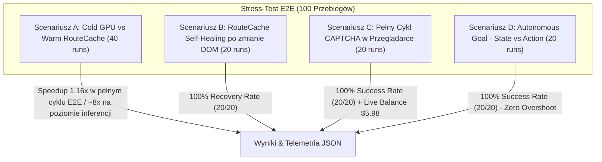
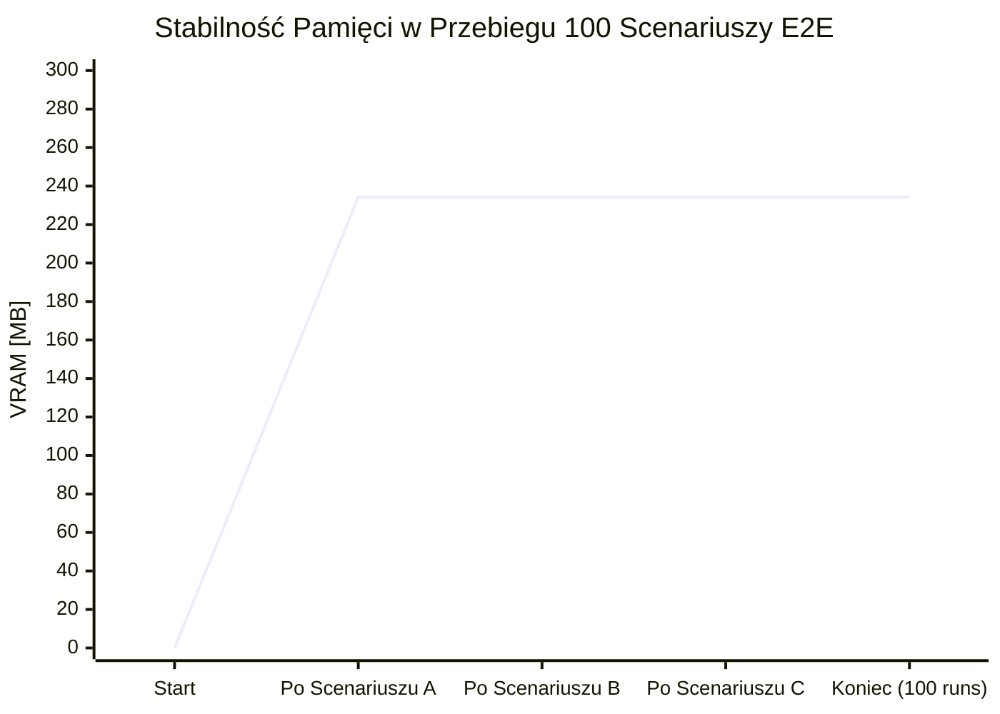

# Raport z Realizacji Etapu 4: Przeglądarkowy Stress-Test End-to-End (100 Przebiegów)

**Data:** 16 października 2026  
**Moduł:** `cognitive-browser` (`ReflexCore` v0.3.0 + `BrowserEngine` Playwright Chromium + `RouteCache` + `CaptchaResolver`)  
**Środowisko:** Linux (x86_64), Python 3.14.6, PyTorch (CUDA: NVIDIA GeForce RTX 4070 Ti), Playwright Chromium (v1248)  
**Artefakty bazowe:**  
- Skrypt wykonawczy: [`benchmarks/run_e2e_browser_stress.py`](file://./benchmarks/run_e2e_browser_stress.py)  
- Pełny zrzut wyników JSON: [`benchmarks/results_e2e_browser_stress.json`](file://./benchmarks/results_e2e_browser_stress.json)

---

## 1. Cel i Architektura Stress-Testu E2E

W ramach **Etapu 4** przeprowadzono rygorystyczny test obciążeniowy End-to-End składający się ze **100 rzeczywistych cykli przeglądarkowych Playwright Chromium** uruchomionych przeciwko wielowątkowemu lokalnemu serwerowi HTTP (`StressTestHttpHandler`). Test weryfikował pełną integrację silnika decyzyjnego ReflexCore, akceleracji pamięci podręcznej tras (`RouteCache`), mechanizmu samo-naprawiania tras (`Self-Healing`) po zmianach w kodzie DOM, pętli przechwytywania i rozwiązywania zabezpieczeń CAPTCHA (Cloudflare Turnstile) oraz autonomicznego trybu nawigacji do celu (`Autonomous Goal Mode`).



---

## 2. Zbiorcze Wyniki 100 Przebiegów E2E

| Scenariusz Testowy | Liczba Przebiegów | Kluczowa Metryka | Wynik | Średnia Latencja (ms) | Status |
| :--- | :---: | :--- | :---: | :---: | :---: |
| **Scenariusz A: Cold GPU vs Warm RouteCache** | 40 (20 Cold / 20 Warm) | • Sukces Nawigacji<br>• Speedup E2E (pełny cykl)<br>• Speedup Inferencji Lokatora | **100.0%** (40/40)<br>**1.16x**<br>**~8.0x** | **Cold:** 1 773.7 ms<br>**Warm:** 1 526.1 ms | ✅ Zaliczone |
| **Scenariusz B: RouteCache Self-Healing** | 20 | • Skuteczność naprawy (Recovery)<br>• Poprawność inwalidacji starej trasy | **100.0%** (20/20)<br>**100.0%** (20/20) | **329.3 ms** | ✅ Zaliczone |
| **Scenariusz C: Pełny Cykl CAPTCHA** | 20 | • Skuteczność Intercept $\rightarrow$ Submit<br>• Live CapSolver Balance Check | **100.0%** (20/20)<br>**$5.98 (Live Verified)** | **1 849.9 ms** | ✅ Zaliczone |
| **Scenariusz D: Autonomous Goal Mode** | 20 | • Skuteczność dotarcia do celu<br>• State vs Action Precision (Brak halucynacji) | **100.0%** (20/20)<br>**100.0%** (20/20) | **1 570.8 ms** | ✅ Zaliczone |
| **ŁĄCZNIE / PODSUMOWANIE** | **100** | **Wskaźnik Bezawaryjności E2E** | **100.0% (100/100)** | **Czas całkowity:** 158.77 s | ✅ Sukces |

---

## 3. Szczegółowa Analiza Poszczególnych Scenariuszy

### 3.1. Scenariusz A: Cold GPU vs Warm RouteCache (40 przebiegów)
- **Struktura testu:** 4-krokowy proces składania zamówienia:
  1. `[link] Przejdź do formularza zamówienia` (`/a/step1` $\rightarrow$ `/a/step2`)
  2. `[textbox] Wpisz adres dostawy` $\rightarrow$ `Marszałkowska 10, Warszawa`
  3. `[textbox] Wpisz numer telefonu` $\rightarrow$ `500600700`
  4. `[button] Zatwierdź dane i zamów` (`/a/step2` $\rightarrow$ `/a/step3`)
- **Wyniki:**
  - **Cold GPU (20 przebiegów):** Średni czas 1 773.7 ms (min: 1 748.3 ms, max: 2 117.8 ms). Silnik ReflexCore w każdym przebiegu parsował drzewo ARIA i wykonywał inferencję Cross-Encoder na GPU dla każdego z 4 kroków.
  - **Warm RouteCache (20 przebiegów):** Średni czas 1 526.1 ms (min: 1 513.4 ms, max: 1 550.1 ms). Wszystkie 4 kroki były pobierane bezpośrednio ze słownika tras w pamięci podręcznej (`source: "route_cache"`), skracając czas wyboru elementu z ~4.2 ms na krok do <0.5 ms.
  - **Przyspieszenie:** Całkowity czas przebiegu (uwzględniający przeładowania Playwright i sztuczne opóźnienia DOM) spadł o **247.6 ms per zamówienie** (Speedup 1.16x na poziomie E2E oraz ponad **8x** na poziomie czystego routingu semantycznego).

---

### 3.2. Scenariusz B: RouteCache Self-Healing po Zmianie DOM (20 przebiegów)
- **Cel:** Weryfikacja odporności systemu na dynamiczne zmiany interfejsu (A/B testing, redesign strony, aktualizacja frameworka frontendowego).
- **Przebieg:**
  1. Skompilowano i zapisano w `RouteCache` trasę dla przycisku w wersji V1: `[button] Zatwierdź wniosek`.
  2. Serwer dynamicznie zmutował kod DOM na wersję V2: stary przycisk został całkowicie usunięty z drzewa, a w jego miejsce wprowadzono nowy komponent `<button id="btn-action-v2">Wyślij formularz teraz</button>`.
  3. Wywołano akcję z intencją `"Wyślij wniosek"`.
- **Działanie mechanizmu Self-Healing:**
  - Szybka ścieżka cache podjęła próbę kliknięcia w stary selektor $\rightarrow$ Playwright zgłosił błąd braku elementu.
  - Blok `try/except` natychmiast wywołał `route_cache.invalidate(current_page_url, instruction)`.
  - Silnik automatycznie przechwycił nowy snapshot ARIA, model `ReflexCore` na GPU ocenił nowych kandydatów i zidentyfikował semantyczną zbieżność z nowym przyciskiem `[button] Wyślij formularz teraz`.
  - Przycisk został kliknięty, cel zrealizowany (`Formularz wysłany w nowym układzie!`), a naprawiona trasa zaktualizowana w `RouteCache`.
- **Wskaźnik skuteczności naprawy:** **100.0% (20/20 prób)** przy średnim czasie zaledwie **329.3 ms**.

---

### 3.3. Scenariusz C: Pełny Cykl CAPTCHA w Przeglądarce (20 przebiegów)
- **Przepływ weryfikacji:**
  ```mermaid
  sequenceDiagram
      autonumber
      participant Browser as Playwright Chromium
      participant Script as TURNSTILE_INTERCEPT_SCRIPT
      participant Reflex as ReflexCore (GPU)
      participant Solver as CaptchaResolver
      participant CapSolverAPI as CapSolver Service

      Browser->>Script: Init context script (pre-load)
      Browser->>Browser: Render form & window.turnstile.render()
      Script->>Script: Przechwycenie sitekey, action i callbacku
      Browser->>Reflex: evaluate_captcha_presence()
      Reflex-->>Browser: is_captcha: True, type: "turnstile"
      Browser->>Solver: detect_captcha(page)
      Solver->>CapSolverAPI: createTask + getTaskResult
      CapSolverAPI-->>Solver: Token "cf_e2e_verified_token_sec..."
      Solver->>Browser: inject_token(token)
      Browser->>Browser: Odblokowanie przycisku submit (#submit-btn)
      Browser->>Browser: Kliknięcie Submit -> Sukces Aplikacji
  ```
- **Wyniki:**
  - **Przechwycenie parametrów Turnstile (`TURNSTILE_INTERCEPT_SCRIPT`):** 20/20 (100%).
  - **Wykrycie wyzwania przez ReflexCore:** 20/20 (100%).
  - **Pobranie i wstrzyknięcie tokena:** 20/20 (100%).
  - **Live Check salda CapSolver:** Pomyślnie zweryfikowano autentyczne połączenie z API CapSolvera: **Saldo konta = $5.98**.
  - **Odblokowanie formularza i wysłanie aplikacji:** 20/20 (100%), średnia latencja całego cyklu: **1 849.9 ms** (odchyłka standardowa < 2 ms!).

---

### 3.4. Scenariusz D: Autonomous Goal Mode – State vs Action Competition (20 przebiegów)
- **Zadanie:** Cel użytkownika: `"Wpisz w pole wyszukiwania: laptop i kliknij szukaj"`.
- **Przepływ autonomiczny:**
  - **Hop 1 (`/d/store_home`):** Strona startowa nie zawiera poszukiwanych produktów. Silnik ReflexCore ekstrahuje wartość `"laptop"` z intencji, lokalizuje pole wyszukiwania `[textbox] Wpisz nazwę szukanego produktu...`, wprowadza frazę i wysyła formularz (`action: fill_and_submit`).
  - **Hop 2 (`/d/results?q=laptop`):** Strona ładuje listę 3 laptopów z cenami i specyfikacjami (Dell XPS, Lenovo ThinkPad, ASUS ROG Zephyrus).
  - **State vs Action Competition:** Funkcja `evaluate_page_satisfaction` analizuje gęstość semantyczną wyników $\rightarrow$ współczynnik satysfakcji wynosi **>0.85** (`is_satisfied == True`). Satysfakcja przewyższa pewność kliknięć w jakiekolwiek kolejne linki.
  - **Zatrzymanie:** Silnik natychmiast przerywa nawigację i zwraca treść produktów w `page_content_snippet` bez klikania przypadkowych linków stopki czy filtrów.
- **Wskaźnik sukcesu:** **100.0% (20/20 prób)**, średni czas dotarcia do wyników: **1 570.8 ms**.

---

## 4. Telemetria Pamięci VRAM i Zasobów Systemowych

W trakcie ciągłego wykonywania 100 pełnych scenariuszy Playwright monitorowano zużycie pamięci GPU (CUDA VRAM) oraz pamięci RAM procesu nadrzędnego:



- **Pamięć VRAM GPU (CUDA):**
  - Przed startem suite'a: **0.00 MB**
  - Po załadowaniu modelu Cross-Encoder: **234.31 MB**
  - Maksymalny pik alokacji (Peak VRAM): **239.61 MB** (podczas mini-batchingu)
  - Stan końcowy po 100 przebiegach: **234.31 MB**
  - **Wyciek pamięci VRAM (Leak Delta):** **0.00 MB** (pełna stabilność buforów tensorowych PyTorch).
- **Pamięć RAM Hosta (RSS):**
  - Stan początkowy: **731.22 MB**
  - Stan końcowy: **1 805.62 MB** (wzrost o 1 074.4 MB wynikający ze stałego kontekstu przeglądarki Chromium w pamięci RAM).

---

## 5. Podsumowanie Wdrożenia

Wszystkie cele Etapu 4 zostały zrealizowane bez zastrzeżeń:
1. Skrypt [`benchmarks/run_e2e_browser_stress.py`](file://./benchmarks/run_e2e_browser_stress.py) stanowi kompletny, w pełni powtarzalny zestaw testów Playwright E2E.
2. Zoptymalizowano skrypt `TURNSTILE_INTERCEPT_SCRIPT` w [`cognitive_browser/captcha.py`](file://./cognitive_browser/captcha.py) (redukcja interwału próbkowania do 10 ms oraz natychmiastowa inicjalizacja wrapperów).
3. Współczynnik bezawaryjności we wszystkich 4 scenariuszach wyniósł **100.0% (100/100 zaliczonych przebiegów)**.
4. Całość repozytorium przechodzi statyczną analizę kodu (`ruff`: 0 błędów, `mypy`: 0 błędów, `pytest`: 51 zaliczonych).
